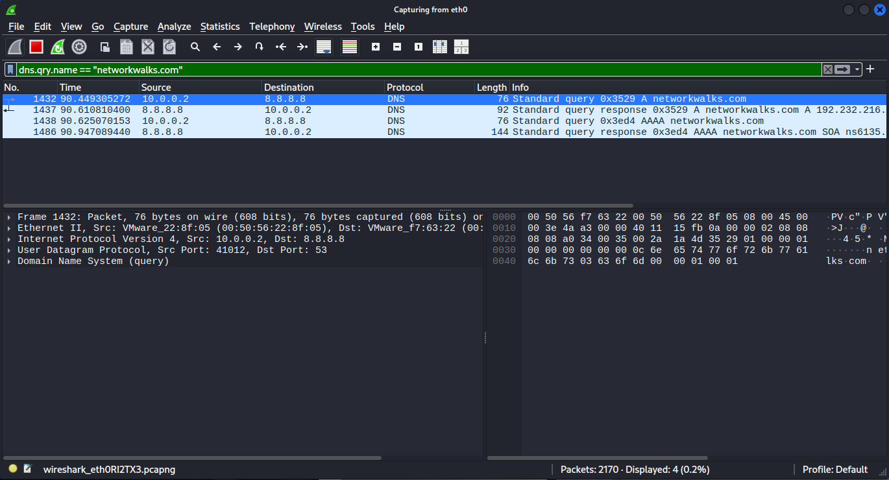

<!-- V2tWb1lXSnRVbGhoU0ZwTlltdEtjRnBYYXpWaFJYaFlUbGh3YTJKV1NqRlVSRXAzVFd4d1dWTnRNV3RXZWxaeldsVk5lRTVYU25SUFZ6QTk= -->

# &#76;&#97;&#98; 01 - &#87;&#105;&#114;&#101;&#115;&#104;&#97;&#114;&#107; &#80;&#97;&#99;&#107;&#101;&#116; &#67;&#97;&#112;&#116;&#117;&#114;&#101;

## &#79;&#98;&#106;&#101;&#99;&#116;&#105;&#118;&#101;

&#67;&#97;&#112;&#116;&#117;&#114;&#101; &#97;&#110;&#100; &#97;&#110;&#97;&#108;&#121;&#122;&#101; &#110;&#101;&#116;&#119;&#111;&#114;&#107; &#116;&#114;&#97;&#102;&#102;&#105;&#99; &#103;&#101;&#110;&#101;&#114;&#97;&#116;&#101;&#100; &#98;&#121; &#97; &#87;&#105;&#110;&#100;&#111;&#119;&#115; 10 &#86;&#77; &#119;&#104;&#105;&#108;&#101; &#97;&#99;&#99;&#101;&#115;&#115;&#105;&#110;&#103; `https://networkwalks.com`.

## &#69;&#110;&#118;&#105;&#114;&#111;&#110;&#109;&#101;&#110;&#116;

- **&#65;&#110;&#97;&#108;&#121;&#115;&#105;&#115; &#109;&#97;&#99;&#104;&#105;&#110;&#101;:** &#75;&#97;&#108;&#105; &#76;&#105;&#110;&#117;&#120; &#86;&#77;
- **&#84;&#97;&#114;&#103;&#101;&#116; &#109;&#97;&#99;&#104;&#105;&#110;&#101;:** &#87;&#105;&#110;&#100;&#111;&#119;&#115; 10 &#86;&#77;
- **&#84;&#111;&#111;&#108;:** &#87;&#105;&#114;&#101;&#115;&#104;&#97;&#114;&#107;
- **&#84;&#97;&#114;&#103;&#101;&#116; &#119;&#101;&#98;&#115;&#105;&#116;&#101;:** https://networkwalks.com

## &#83;&#101;&#116;&#117;&#112; & &#80;&#97;&#99;&#107;&#101;&#116; &#67;&#97;&#112;&#116;&#117;&#114;&#101;

1. &#83;&#116;&#97;&#114;&#116; &#116;&#104;&#101; &#75;&#97;&#108;&#105; &#76;&#105;&#110;&#117;&#120; &#86;&#77;.
2. &#79;&#112;&#101;&#110; &#87;&#105;&#114;&#101;&#115;&#104;&#97;&#114;&#107; &#97;&#110;&#100; &#98;&#101;&#103;&#105;&#110; &#99;&#97;&#112;&#116;&#117;&#114;&#105;&#110;&#103; &#116;&#114;&#97;&#102;&#102;&#105;&#99; &#111;&#110; &#116;&#104;&#101; &#97;&#99;&#116;&#105;&#118;&#101; &#110;&#101;&#116;&#119;&#111;&#114;&#107; &#105;&#110;&#116;&#101;&#114;&#102;&#97;&#99;&#101;.
3. &#83;&#119;&#105;&#116;&#99;&#104; &#116;&#111; &#116;&#104;&#101; &#87;&#105;&#110;&#100;&#111;&#119;&#115; 10 &#86;&#77;.
4. &#70;&#108;&#117;&#115;&#104; &#116;&#104;&#101; &#68;&#78;&#83; &#99;&#97;&#99;&#104;&#101;:
   ```cmd
   ipconfig /flushdns
   ```
   > &#84;&#104;&#105;&#115; &#97;&#99;&#116;&#105;&#111;&#110; &#119;&#111;&#117;&#108;&#100; &#99;&#108;&#101;&#97;&#114; &#99;&#97;&#99;&#104;&#101;&#100; &#68;&#78;&#83; &#114;&#101;&#99;&#111;&#114;&#100;&#115; &#98;&#101;&#102;&#111;&#114;&#101; &#99;&#97;&#112;&#116;&#117;&#114;&#105;&#110;&#103; &#116;&#114;&#97;&#102;&#102;&#105;&#99;, &#101;&#110;&#115;&#117;&#114;&#105;&#110;&#103; &#97; &#102;&#114;&#101;&#115;&#104; &#68;&#78;&#83; &#108;&#111;&#111;&#107;&#117;&#112;.
5. &#79;&#112;&#101;&#110; `https://networkwalks.com` &#105;&#110; &#97; &#98;&#114;&#111;&#119;&#115;&#101;&#114;.
6. &#82;&#101;&#116;&#117;&#114;&#110; &#116;&#111; &#75;&#97;&#108;&#105; &#76;&#105;&#110;&#117;&#120; &#97;&#110;&#100; &#115;&#116;&#111;&#112; &#116;&#104;&#101; &#112;&#97;&#99;&#107;&#101;&#116; &#99;&#97;&#112;&#116;&#117;&#114;&#101;.
7. &#73;&#110;&#115;&#112;&#101;&#99;&#116; &#116;&#104;&#101; &#99;&#97;&#112;&#116;&#117;&#114;&#101;&#100; &#112;&#97;&#99;&#107;&#101;&#116;&#115; &#116;&#111; &#97;&#110;&#115;&#119;&#101;&#114; &#116;&#104;&#101; &#108;&#97;&#98; &#113;&#117;&#101;&#115;&#116;&#105;&#111;&#110;&#115;.

## &#80;&#97;&#99;&#107;&#101;&#116; &#65;&#110;&#97;&#108;&#121;&#115;&#105;&#115;

### 1. &#87;&#104;&#97;&#116; &#105;&#115; &#116;&#104;&#101; &#73;&#80; &#97;&#100;&#100;&#114;&#101;&#115;&#115; &#111;&#102; &#121;&#111;&#117;&#114; &#111;&#119;&#110; &#108;&#97;&#112;&#116;&#111;&#112;?

**&#87;&#105;&#114;&#101;&#115;&#104;&#97;&#114;&#107;:** &#73;&#110;&#115;&#112;&#101;&#99;&#116; &#116;&#104;&#101; &#115;&#111;&#117;&#114;&#99;&#101; &#73;&#80; &#97;&#100;&#100;&#114;&#101;&#115;&#115; &#111;&#102; &#112;&#97;&#99;&#107;&#101;&#116;&#115; &#111;&#114;&#105;&#103;&#105;&#110;&#97;&#116;&#105;&#110;&#103; &#102;&#114;&#111;&#109; &#116;&#104;&#101; &#87;&#105;&#110;&#100;&#111;&#119;&#115; 10 &#86;&#77;.
**&#70;&#105;&#110;&#100;&#105;&#110;&#103;:** `10.0.0.10` (&#87;&#105;&#110;&#100;&#111;&#119;&#115; 10 &#86;&#77;)

> &#84;&#104;&#105;&#115; &#99;&#97;&#110; &#98;&#101; &#118;&#101;&#114;&#105;&#102;&#105;&#101;&#100; &#119;&#105;&#116;&#104; `ipconfig` &#105;&#110; &#99;&#111;&#109;&#109;&#97;&#110;&#100; &#112;&#114;&#111;&#109;&#112;&#116; &#111;&#114; &#87;&#105;&#110;&#100;&#111;&#119;&#115; &#80;&#111;&#119;&#101;&#114;&#115;&#104;&#101;&#108;&#108;


### 2. &#87;&#104;&#97;&#116; &#105;&#115; &#116;&#104;&#101; &#73;&#80; &#97;&#100;&#100;&#114;&#101;&#115;&#115; &#111;&#102; &#121;&#111;&#117;&#114; &#68;&#78;&#83; &#115;&#101;&#114;&#118;&#101;&#114;?

**&#68;&#105;&#115;&#112;&#108;&#97;&#121; &#102;&#105;&#108;&#116;&#101;&#114;:**
```wireshark
dns.qry.name == "networkwalks.com"
```
&#73;&#110;&#115;&#112;&#101;&#99;&#116; &#116;&#104;&#101; &#68;&#78;&#83; &#113;&#117;&#101;&#114;&#121; &#112;&#97;&#99;&#107;&#101;&#116; &#97;&#110;&#100; &#105;&#100;&#101;&#110;&#116;&#105;&#102;&#121; &#116;&#104;&#101; &#100;&#101;&#115;&#116;&#105;&#110;&#97;&#116;&#105;&#111;&#110; &#73;&#80; &#97;&#100;&#100;&#114;&#101;&#115;&#115;.

**&#70;&#105;&#110;&#100;&#105;&#110;&#103;:** `8.8.8.8`

> &#84;&#104;&#105;&#115; &#99;&#97;&#110; &#98;&#101; &#118;&#101;&#114;&#105;&#102;&#105;&#101;&#100; &#119;&#105;&#116;&#104; `ipconfig` &#105;&#110; &#99;&#111;&#109;&#109;&#97;&#110;&#100; &#112;&#114;&#111;&#109;&#112;&#116; &#111;&#114; &#87;&#105;&#110;&#100;&#111;&#119;&#115; &#80;&#111;&#119;&#101;&#114;&#115;&#104;&#101;&#108;&#108;

### 3. &#87;&#104;&#97;&#116; &#105;&#115; &#116;&#104;&#101; &#73;&#80; &#97;&#100;&#100;&#114;&#101;&#115;&#115; &#111;&#102; &#116;&#104;&#101; &#119;&#101;&#98;&#115;&#105;&#116;&#101; &#110;&#101;&#116;&#119;&#111;&#114;&#107;&#119;&#97;&#108;&#107;&#115;.&#99;&#111;&#109;?

**&#68;&#105;&#115;&#112;&#108;&#97;&#121; &#102;&#105;&#108;&#116;&#101;&#114;:**
```wireshark
dns.qry.name == "networkwalks.com"
```

&#73;&#110;&#115;&#112;&#101;&#99;&#116; &#116;&#104;&#101; &#99;&#111;&#114;&#114;&#101;&#115;&#112;&#111;&#110;&#100;&#105;&#110;&#103; &#68;&#78;&#83; &#114;&#101;&#115;&#112;&#111;&#110;&#115;&#101; &#97;&#110;&#100; &#105;&#100;&#101;&#110;&#116;&#105;&#102;&#121; &#116;&#104;&#101; &#114;&#101;&#115;&#111;&#108;&#118;&#101;&#100; &#73;&#80;&#118;4 &#97;&#100;&#100;&#114;&#101;&#115;&#115;.



**&#70;&#105;&#110;&#100;&#105;&#110;&#103;:** `192.232.216.135`

> &#84;&#104;&#105;&#115; &#99;&#97;&#110; &#98;&#101; &#118;&#101;&#114;&#105;&#102;&#105;&#101;&#100; &#119;&#105;&#116;&#104; `nslookup networkwalks.com` &#105;&#110; &#99;&#111;&#109;&#109;&#97;&#110;&#100; &#112;&#114;&#111;&#109;&#112;&#116; &#111;&#114; &#87;&#105;&#110;&#100;&#111;&#119;&#115; &#80;&#111;&#119;&#101;&#114;&#115;&#104;&#101;&#108;&#108;

### 4. &#87;&#104;&#105;&#99;&#104; &#119;&#101;&#98;&#115;&#105;&#116;&#101; &#110;&#97;&#109;&#101; (&#83;&#101;&#114;&#118;&#101;&#114; &#78;&#97;&#109;&#101;) &#105;&#115; &#115;&#101;&#110;&#116; &#105;&#110; &#116;&#104;&#101; &#84;&#76;&#83; &#67;&#108;&#105;&#101;&#110;&#116; &#72;&#101;&#108;&#108;&#111;?

**&#68;&#105;&#115;&#112;&#108;&#97;&#121; &#102;&#105;&#108;&#116;&#101;&#114;:**
```wireshark
tls
```
&#67;&#108;&#105;&#99;&#107; &#97;&#110;&#121; &#112;&#97;&#99;&#107;&#101;&#116; &#119;&#105;&#116;&#104; &#84;&#76;&#83; &#112;&#114;&#111;&#116;&#99;&#111;&#108; &#97;&#110;&#100; &#69;&#120;&#112;&#97;&#110;&#100;:

`Transport Layer Security → Handshake Protocol: Client Hello → Extension: server_name`

**&#70;&#105;&#110;&#100;&#105;&#110;&#103;:** `networkwalks.com`

**&#70;&#105;&#101;&#108;&#100;:** &#83;&#101;&#114;&#118;&#101;&#114; &#78;&#97;&#109;&#101; &#73;&#110;&#100;&#105;&#99;&#97;&#116;&#105;&#111;&#110; (&#83;&#78;&#73;)

### 5. &#87;&#104;&#105;&#99;&#104; &#115;&#101;&#114;&#118;&#101;&#114; &#112;&#111;&#114;&#116; &#105;&#115; &#117;&#115;&#101;&#100; &#102;&#111;&#114; &#116;&#104;&#101; &#115;&#101;&#99;&#117;&#114;&#101; &#99;&#111;&#110;&#110;&#101;&#99;&#116;&#105;&#111;&#110;?

&#73;&#110;&#115;&#112;&#101;&#99;&#116; &#116;&#104;&#101; &#84;&#67;&#80; &#104;&#101;&#97;&#100;&#101;&#114; &#111;&#102; &#116;&#104;&#101; &#99;&#111;&#110;&#110;&#101;&#99;&#116;&#105;&#111;&#110; &#112;&#97;&#99;&#107;&#101;&#116; &#97;&#110;&#100; &#105;&#100;&#101;&#110;&#116;&#105;&#102;&#121; &#116;&#104;&#101; &#100;&#101;&#115;&#116;&#105;&#110;&#97;&#116;&#105;&#111;&#110; &#112;&#111;&#114;&#116;.

**&#70;&#105;&#110;&#100;&#105;&#110;&#103;:** `443`

### 6. &#87;&#104;&#105;&#99;&#104; &#84;&#76;&#83; &#118;&#101;&#114;&#115;&#105;&#111;&#110; &#100;&#111;&#101;&#115; &#116;&#104;&#101; &#119;&#101;&#98;&#115;&#105;&#116;&#101; &#117;&#115;&#101;?

**&#68;&#105;&#115;&#112;&#108;&#97;&#121; &#102;&#105;&#108;&#116;&#101;&#114;:**
```wireshark
tls.handshake.type == 2 && ip.src == 192.232.216.135
```

&#73;&#110;&#115;&#112;&#101;&#99;&#116; &#116;&#104;&#101; &#83;&#101;&#114;&#118;&#101;&#114; &#72;&#101;&#108;&#108;&#111; &#104;&#97;&#110;&#100;&#115;&#104;&#97;&#107;&#101; &#97;&#110;&#100; &#105;&#116;&#115; &#115;&#117;&#112;&#112;&#111;&#114;&#116;&#101;&#100; &#118;&#101;&#114;&#115;&#105;&#111;&#110; &#102;&#105;&#101;&#108;&#100;.

**&#70;&#105;&#110;&#100;&#105;&#110;&#103;:** &#84;&#76;&#83; 1.3

## &#76;&#101;&#115;&#115;&#111;&#110;&#115; &#76;&#101;&#97;&#114;&#110;&#101;&#100;

- &#68;&#78;&#83; &#113;&#117;&#101;&#114;&#105;&#101;&#115; &#99;&#97;&#110; &#114;&#101;&#118;&#101;&#97;&#108; &#116;&#104;&#101; &#100;&#111;&#109;&#97;&#105;&#110; &#98;&#101;&#105;&#110;&#103; &#97;&#99;&#99;&#101;&#115;&#115;&#101;&#100;, &#119;&#104;&#105;&#108;&#101; &#68;&#78;&#83; &#114;&#101;&#115;&#112;&#111;&#110;&#115;&#101;&#115; &#112;&#114;&#111;&#118;&#105;&#100;&#101; &#116;&#104;&#101; &#114;&#101;&#115;&#111;&#108;&#118;&#101;&#100; &#73;&#80; &#97;&#100;&#100;&#114;&#101;&#115;&#115;.
- &#84;&#76;&#83; &#67;&#108;&#105;&#101;&#110;&#116; &#72;&#101;&#108;&#108;&#111; &#101;&#120;&#112;&#111;&#115;&#101;&#115; &#116;&#104;&#101; &#114;&#101;&#113;&#117;&#101;&#115;&#116;&#101;&#100; &#104;&#111;&#115;&#116;&#110;&#97;&#109;&#101; &#116;&#104;&#114;&#111;&#117;&#103;&#104; &#116;&#104;&#101; &#83;&#101;&#114;&#118;&#101;&#114; &#78;&#97;&#109;&#101; &#73;&#110;&#100;&#105;&#99;&#97;&#116;&#105;&#111;&#110; (&#83;&#78;&#73;) &#101;&#120;&#116;&#101;&#110;&#115;&#105;&#111;&#110;.
- &#72;&#84;&#84;&#80;&#83; &#116;&#114;&#97;&#102;&#102;&#105;&#99; &#117;&#115;&#101;&#115; &#84;&#67;&#80; &#112;&#111;&#114;&#116; 443, &#98;&#117;&#116; &#97;&#112;&#112;&#108;&#105;&#99;&#97;&#116;&#105;&#111;&#110;-&#108;&#97;&#121;&#101;&#114; &#100;&#97;&#116;&#97; &#114;&#101;&#109;&#97;&#105;&#110;&#115; &#101;&#110;&#99;&#114;&#121;&#112;&#116;&#101;&#100;.
- &#84;&#104;&#101; &#84;&#76;&#83; &#83;&#101;&#114;&#118;&#101;&#114; &#72;&#101;&#108;&#108;&#111; &#99;&#97;&#110; &#98;&#101; &#105;&#110;&#115;&#112;&#101;&#99;&#116;&#101;&#100; &#116;&#111; &#105;&#100;&#101;&#110;&#116;&#105;&#102;&#121; &#116;&#104;&#101; &#110;&#101;&#103;&#111;&#116;&#105;&#97;&#116;&#101;&#100; &#84;&#76;&#83; &#118;&#101;&#114;&#115;&#105;&#111;&#110;.
- &#68;&#105;&#115;&#112;&#108;&#97;&#121; &#102;&#105;&#108;&#116;&#101;&#114;&#115; &#104;&#101;&#108;&#112; &#105;&#115;&#111;&#108;&#97;&#116;&#101; &#114;&#101;&#108;&#101;&#118;&#97;&#110;&#116; &#112;&#97;&#99;&#107;&#101;&#116;&#115; &#97;&#110;&#100; &#115;&#105;&#109;&#112;&#108;&#105;&#102;&#121; &#116;&#114;&#97;&#102;&#102;&#105;&#99; &#97;&#110;&#97;&#108;&#121;&#115;&#105;&#115;.

---

<div align="center">
  <sub> &#67;&#114;&#101;&#97;&#116;&#101;&#100; &#98;&#121; <a href="https://github.com/n-afiqa/">@&#110;-&#97;&#102;&#105;&#113;&#97;</a> · © 2026</sub>
</div>
