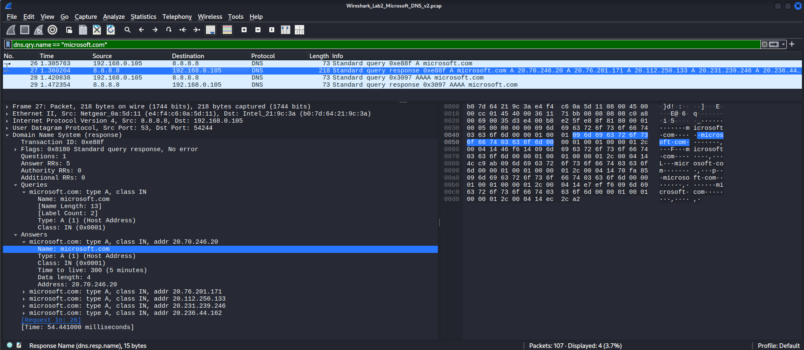
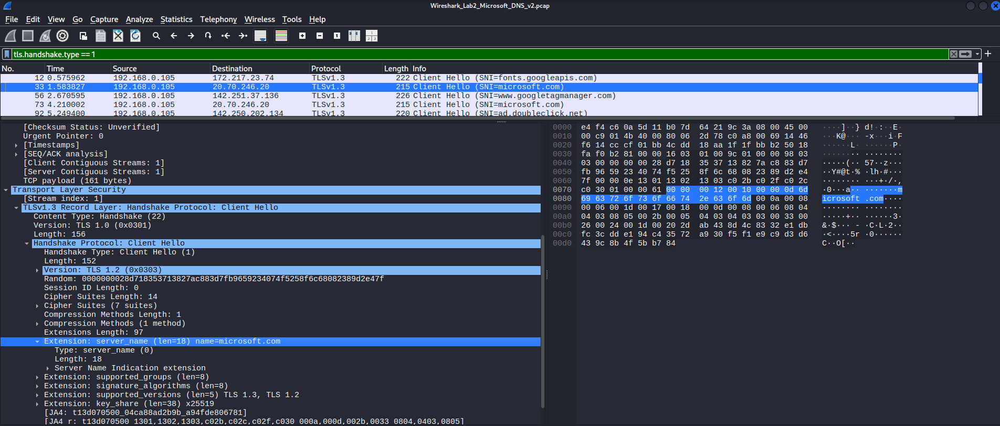

<!-- V2tWb1lXSnRVbGhoU0ZwTlltdEtjRnBYYXpWaFJYaFlUbGh3YTJKV1NqRlVSRXAzVFd4d1dWTnRNV3RXZWxaeldsVk5lRTVYU25SUFZ6QTk= -->

# &#76;&#97;&#98; 02 - &#87;&#105;&#114;&#101;&#115;&#104;&#97;&#114;&#107; &#80;&#67;&#65;&#80; &#65;&#110;&#97;&#108;&#121;&#115;&#105;&#115;

## &#79;&#98;&#106;&#101;&#99;&#116;&#105;&#118;&#101;

&#65;&#110;&#97;&#108;&#121;&#122;&#101; &#97; &#112;&#114;&#111;&#118;&#105;&#100;&#101;&#100; &#80;&#67;&#65;&#80; &#102;&#105;&#108;&#101; &#116;&#111; &#105;&#110;&#118;&#101;&#115;&#116;&#105;&#103;&#97;&#116;&#101; &#68;&#78;&#83; &#113;&#117;&#101;&#114;&#105;&#101;&#115;, &#68;&#78;&#83; &#114;&#101;&#115;&#112;&#111;&#110;&#115;&#101;&#115;, &#97;&#110;&#100; &#84;&#76;&#83; &#104;&#97;&#110;&#100;&#115;&#104;&#97;&#107;&#101; &#105;&#110;&#102;&#111;&#114;&#109;&#97;&#116;&#105;&#111;&#110; &#114;&#101;&#108;&#97;&#116;&#101;&#100; &#116;&#111; `microsoft.com`.

## &#69;&#110;&#118;&#105;&#114;&#111;&#110;&#109;&#101;&#110;&#116;

- **&#79;&#83;:** &#75;&#97;&#108;&#105; &#76;&#105;&#110;&#117;&#120; &#86;&#77;
- **&#84;&#111;&#111;&#108;:** &#87;&#105;&#114;&#101;&#115;&#104;&#97;&#114;&#107;
- **&#67;&#97;&#112;&#116;&#117;&#114;&#101; &#102;&#105;&#108;&#101;:** `Wireshark_Lab2_Microsoft_DNS_v2.pcap`
- **&#65;&#110;&#97;&#108;&#121;&#115;&#105;&#115; &#116;&#121;&#112;&#101;:** &#79;&#102;&#102;&#108;&#105;&#110;&#101; &#80;&#67;&#65;&#80; &#97;&#110;&#97;&#108;&#121;&#115;&#105;&#115;

## &#68;&#111;&#119;&#110;&#108;&#111;&#97;&#100; &#80;&#67;&#65;&#80; &#70;&#105;&#108;&#101;

1. &#68;&#111;&#119;&#110;&#108;&#111;&#97;&#100; &#116;&#104;&#101; &#80;&#67;&#65;&#80; &#97;&#114;&#99;&#104;&#105;&#118;&#101;:
   ```bash
   wget https://networkwalks.com/wp-content/uploads/2022/06/WK1-PM4.c-Practice-Lab-Wireshark-PCAP-Analysis-v1.zip
   ```
2. &#69;&#120;&#116;&#114;&#97;&#99;&#116; &#116;&#104;&#101; &#97;&#114;&#99;&#104;&#105;&#118;&#101;:
   ```bash
   unzip WK1-PM4.c-Practice-Lab-Wireshark-PCAP-Analysis-v1.zip
   ```
3. &#82;&#101;&#110;&#97;&#109;&#101; &#116;&#104;&#101; &#101;&#120;&#116;&#114;&#97;&#99;&#116;&#101;&#100; &#80;&#67;&#65;&#80; &#102;&#105;&#108;&#101;:
   ```bash
   mv 'WK1-PM4.c - Practice Lab - Wireshark PCAP Analysis v1.pcap' Wireshark_Lab2_Microsoft_DNS_v2.pcap
   ```
4. &#79;&#112;&#101;&#110; &#116;&#104;&#101; &#80;&#67;&#65;&#80; &#102;&#105;&#108;&#101; &#105;&#110; &#87;&#105;&#114;&#101;&#115;&#104;&#97;&#114;&#107;:
   ```bash
   wireshark Wireshark_Lab2_Microsoft_DNS_v2.pcap
   ```

## &#80;&#97;&#99;&#107;&#101;&#116; &#65;&#110;&#97;&#108;&#121;&#115;&#105;&#115;

### 1. &#87;&#104;&#97;&#116; &#105;&#115; &#116;&#104;&#101; &#73;&#80; &#97;&#100;&#100;&#114;&#101;&#115;&#115; &#111;&#102; &#116;&#104;&#101; &#108;&#97;&#112;&#116;&#111;&#112; &#116;&#104;&#97;&#116; &#116;&#111;&#111;&#107; &#116;&#104;&#105;&#115; &#99;&#97;&#112;&#116;&#117;&#114;&#101;?

&#73;&#110;&#115;&#112;&#101;&#99;&#116; &#116;&#104;&#101; &#115;&#111;&#117;&#114;&#99;&#101; &#73;&#80; &#97;&#100;&#100;&#114;&#101;&#115;&#115;&#101;&#115; &#105;&#110; &#116;&#104;&#101; &#99;&#97;&#112;&#116;&#117;&#114;&#101;&#100; &#116;&#114;&#97;&#102;&#102;&#105;&#99; &#116;&#111; &#105;&#100;&#101;&#110;&#116;&#105;&#102;&#121; &#116;&#104;&#101; &#111;&#114;&#105;&#103;&#105;&#110;&#97;&#116;&#105;&#110;&#103; &#104;&#111;&#115;&#116;.

**&#70;&#105;&#110;&#100;&#105;&#110;&#103;:** `192.168.0.105`

### 2. &#87;&#104;&#97;&#116; &#105;&#115; &#116;&#104;&#101; &#73;&#80; &#97;&#100;&#100;&#114;&#101;&#115;&#115; &#111;&#102; &#116;&#104;&#101; &#68;&#78;&#83; &#115;&#101;&#114;&#118;&#101;&#114;?

&#73;&#110;&#115;&#112;&#101;&#99;&#116; &#116;&#104;&#101; &#100;&#101;&#115;&#116;&#105;&#110;&#97;&#116;&#105;&#111;&#110; &#73;&#80; &#97;&#100;&#100;&#114;&#101;&#115;&#115; &#111;&#102; &#116;&#104;&#101; &#68;&#78;&#83; &#113;&#117;&#101;&#114;&#121; &#112;&#97;&#99;&#107;&#101;&#116;&#115;.

**&#70;&#105;&#110;&#100;&#105;&#110;&#103;:** `8.8.8.8`

### 3. &#87;&#104;&#105;&#99;&#104; &#73;&#80; &#97;&#100;&#100;&#114;&#101;&#115;&#115;&#101;&#115; &#100;&#105;&#100; &#116;&#104;&#101; &#68;&#78;&#83; &#115;&#101;&#114;&#118;&#101;&#114; &#114;&#101;&#116;&#117;&#114;&#110; &#102;&#111;&#114; &#109;&#105;&#99;&#114;&#111;&#115;&#111;&#102;&#116;.&#99;&#111;&#109;?

**&#68;&#105;&#115;&#112;&#108;&#97;&#121; &#102;&#105;&#108;&#116;&#101;&#114;:**
```wireshark
dns.qry.name == "microsoft.com"
```

&#73;&#110;&#115;&#112;&#101;&#99;&#116; &#116;&#104;&#101; &#99;&#111;&#114;&#114;&#101;&#115;&#112;&#111;&#110;&#100;&#105;&#110;&#103; &#68;&#78;&#83; &#114;&#101;&#115;&#112;&#111;&#110;&#115;&#101; &#97;&#110;&#100; &#105;&#116;&#115; &#97;&#110;&#115;&#119;&#101;&#114; &#114;&#101;&#99;&#111;&#114;&#100;&#115;.



**&#70;&#105;&#110;&#100;&#105;&#110;&#103;:**
- `20.76.201.171`
- `20.112.250.133`
- `20.231.239.246`
- `20.236.44.162`

### 4. &#87;&#104;&#105;&#99;&#104; &#119;&#101;&#98;&#115;&#105;&#116;&#101; &#110;&#97;&#109;&#101; (&#83;&#101;&#114;&#118;&#101;&#114; &#78;&#97;&#109;&#101;) &#105;&#115; &#115;&#101;&#110;&#116; &#105;&#110; &#116;&#104;&#101; &#84;&#76;&#83; &#67;&#108;&#105;&#101;&#110;&#116; &#72;&#101;&#108;&#108;&#111;?

**&#68;&#105;&#115;&#112;&#108;&#97;&#121; &#102;&#105;&#108;&#116;&#101;&#114;:**
```wireshark
tls.handshake.type == 1
```


&#73;&#110;&#115;&#112;&#101;&#99;&#116; &#116;&#104;&#101; &#67;&#108;&#105;&#101;&#110;&#116; &#72;&#101;&#108;&#108;&#111; &#112;&#97;&#99;&#107;&#101;&#116;&#115; &#97;&#110;&#100; &#108;&#111;&#99;&#97;&#116;&#101; &#116;&#104;&#101; &#112;&#97;&#99;&#107;&#101;&#116; &#97;&#115;&#115;&#111;&#99;&#105;&#97;&#116;&#101;&#100; &#119;&#105;&#116;&#104; &#116;&#104;&#101; &#109;&#105;&#99;&#114;&#111;&#115;&#111;&#102;&#116;.&#99;&#111;&#109; &#99;&#111;&#110;&#110;&#101;&#99;&#116;&#105;&#111;&#110;. &#85;&#115;&#101; &#116;&#104;&#101; &#100;&#101;&#115;&#116;&#105;&#110;&#97;&#116;&#105;&#111;&#110; &#73;&#80; &#97;&#100;&#100;&#114;&#101;&#115;&#115; &#102;&#114;&#111;&#109; &#116;&#104;&#101; &#68;&#78;&#83; &#114;&#101;&#115;&#112;&#111;&#110;&#115;&#101; &#116;&#111; &#99;&#111;&#114;&#114;&#101;&#108;&#97;&#116;&#101; &#116;&#104;&#101; &#99;&#111;&#110;&#110;&#101;&#99;&#116;&#105;&#111;&#110;.

`Transport Layer Security → Handshake Protocol: Client Hello → Extension: server_name`

**&#70;&#105;&#110;&#100;&#105;&#110;&#103;:** `microsoft.com`

**&#70;&#105;&#101;&#108;&#100;:** &#83;&#101;&#114;&#118;&#101;&#114; &#78;&#97;&#109;&#101; &#73;&#110;&#100;&#105;&#99;&#97;&#116;&#105;&#111;&#110; (&#83;&#78;&#73;)

### 5. &#87;&#104;&#105;&#99;&#104; &#115;&#101;&#114;&#118;&#101;&#114; &#112;&#111;&#114;&#116; &#105;&#115; &#117;&#115;&#101;&#100; &#102;&#111;&#114; &#116;&#104;&#101; &#115;&#101;&#99;&#117;&#114;&#101; &#99;&#111;&#110;&#110;&#101;&#99;&#116;&#105;&#111;&#110;?

&#73;&#110;&#115;&#112;&#101;&#99;&#116; &#116;&#104;&#101; &#84;&#67;&#80; &#104;&#101;&#97;&#100;&#101;&#114; &#111;&#102; &#116;&#104;&#101; &#99;&#111;&#110;&#110;&#101;&#99;&#116;&#105;&#111;&#110; &#112;&#97;&#99;&#107;&#101;&#116; &#97;&#110;&#100; &#105;&#100;&#101;&#110;&#116;&#105;&#102;&#121; &#116;&#104;&#101; &#100;&#101;&#115;&#116;&#105;&#110;&#97;&#116;&#105;&#111;&#110; &#112;&#111;&#114;&#116;.

**&#70;&#105;&#110;&#100;&#105;&#110;&#103;:** `443`

### 6. &#87;&#104;&#105;&#99;&#104; &#84;&#76;&#83; &#118;&#101;&#114;&#115;&#105;&#111;&#110; &#100;&#111;&#101;&#115; &#116;&#104;&#101; &#119;&#101;&#98;&#115;&#105;&#116;&#101; &#117;&#115;&#101;?

**&#68;&#105;&#115;&#112;&#108;&#97;&#121; &#102;&#105;&#108;&#116;&#101;&#114;:**
```wireshark
tls.handshake.type == 2
```

&#73;&#110;&#115;&#112;&#101;&#99;&#116; &#116;&#104;&#101; &#83;&#101;&#114;&#118;&#101;&#114; &#72;&#101;&#108;&#108;&#111; &#104;&#97;&#110;&#100;&#115;&#104;&#97;&#107;&#101; &#97;&#110;&#100; &#105;&#116;&#115; &#115;&#117;&#112;&#112;&#111;&#114;&#116;&#101;&#100; &#118;&#101;&#114;&#115;&#105;&#111;&#110; &#102;&#105;&#101;&#108;&#100;.

**&#70;&#105;&#110;&#100;&#105;&#110;&#103;:** &#84;&#76;&#83; 1.3

> &#65;&#108;&#116;&#101;&#114;&#110;&#97;&#116;&#105;&#118;&#101;&#108;&#121;, &#99;&#104;&#101;&#99;&#107; &#116;&#104;&#101; &#80;&#114;&#111;&#116;&#111;&#99;&#111;&#108; &#99;&#111;&#108;&#117;&#109;&#110;, &#119;&#104;&#105;&#99;&#104; &#100;&#105;&#115;&#112;&#108;&#97;&#121;&#115; &#116;&#104;&#101; &#84;&#76;&#83; &#118;&#101;&#114;&#115;&#105;&#111;&#110; &#97;&#115; `TLSv1.3`.

## &#76;&#101;&#115;&#115;&#111;&#110;&#115; &#76;&#101;&#97;&#114;&#110;&#101;&#100;

- &#83;&#111;&#117;&#114;&#99;&#101; &#97;&#110;&#100; &#100;&#101;&#115;&#116;&#105;&#110;&#97;&#116;&#105;&#111;&#110; &#73;&#80; &#97;&#100;&#100;&#114;&#101;&#115;&#115;&#101;&#115; &#99;&#97;&#110; &#98;&#101; &#117;&#115;&#101;&#100; &#116;&#111; &#105;&#100;&#101;&#110;&#116;&#105;&#102;&#121; &#99;&#111;&#109;&#109;&#117;&#110;&#105;&#99;&#97;&#116;&#105;&#110;&#103; &#104;&#111;&#115;&#116;&#115; &#97;&#110;&#100; &#68;&#78;&#83; &#115;&#101;&#114;&#118;&#101;&#114;&#115; &#105;&#110; &#97; &#80;&#67;&#65;&#80; &#102;&#105;&#108;&#101;.
- &#68;&#78;&#83; &#114;&#101;&#115;&#112;&#111;&#110;&#115;&#101; &#112;&#97;&#99;&#107;&#101;&#116;&#115; &#99;&#111;&#110;&#116;&#97;&#105;&#110; &#97;&#110;&#115;&#119;&#101;&#114; &#114;&#101;&#99;&#111;&#114;&#100;&#115; &#116;&#104;&#97;&#116; &#109;&#97;&#121; &#105;&#110;&#99;&#108;&#117;&#100;&#101; &#109;&#117;&#108;&#116;&#105;&#112;&#108;&#101; &#73;&#80; &#97;&#100;&#100;&#114;&#101;&#115;&#115;&#101;&#115; &#102;&#111;&#114; &#97; &#115;&#105;&#110;&#103;&#108;&#101; &#100;&#111;&#109;&#97;&#105;&#110;.
- &#84;&#76;&#83; &#67;&#108;&#105;&#101;&#110;&#116; &#72;&#101;&#108;&#108;&#111; &#112;&#97;&#99;&#107;&#101;&#116;&#115; &#99;&#97;&#110; &#101;&#120;&#112;&#111;&#115;&#101; &#116;&#104;&#101; &#114;&#101;&#113;&#117;&#101;&#115;&#116;&#101;&#100; &#104;&#111;&#115;&#116;&#110;&#97;&#109;&#101; &#116;&#104;&#114;&#111;&#117;&#103;&#104; &#116;&#104;&#101; &#83;&#101;&#114;&#118;&#101;&#114; &#78;&#97;&#109;&#101; &#73;&#110;&#100;&#105;&#99;&#97;&#116;&#105;&#111;&#110; (&#83;&#78;&#73;) &#101;&#120;&#116;&#101;&#110;&#115;&#105;&#111;&#110;.
- &#84;&#67;&#80; &#100;&#101;&#115;&#116;&#105;&#110;&#97;&#116;&#105;&#111;&#110; &#112;&#111;&#114;&#116; 443 &#105;&#115; &#99;&#111;&#109;&#109;&#111;&#110;&#108;&#121; &#117;&#115;&#101;&#100; &#102;&#111;&#114; &#72;&#84;&#84;&#80;&#83; &#99;&#111;&#110;&#110;&#101;&#99;&#116;&#105;&#111;&#110;&#115;.
- &#84;&#76;&#83; &#83;&#101;&#114;&#118;&#101;&#114; &#72;&#101;&#108;&#108;&#111; &#112;&#97;&#99;&#107;&#101;&#116;&#115; &#114;&#101;&#118;&#101;&#97;&#108; &#116;&#104;&#101; &#110;&#101;&#103;&#111;&#116;&#105;&#97;&#116;&#101;&#100; &#84;&#76;&#83; &#118;&#101;&#114;&#115;&#105;&#111;&#110; &#116;&#104;&#114;&#111;&#117;&#103;&#104; &#116;&#104;&#101; &#83;&#117;&#112;&#112;&#111;&#114;&#116;&#101;&#100; &#86;&#101;&#114;&#115;&#105;&#111;&#110; &#102;&#105;&#101;&#108;&#100;.

---

<div align="center">
  <sub> &#67;&#114;&#101;&#97;&#116;&#101;&#100; &#98;&#121; <a href="https://github.com/n-afiqa/">@&#110;-&#97;&#102;&#105;&#113;&#97;</a> · © 2026</sub>
</div>
