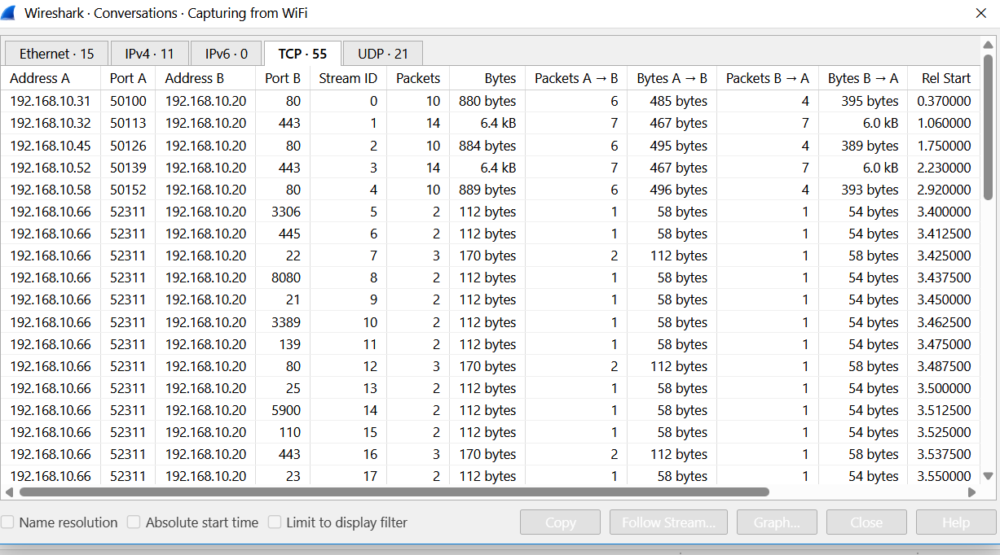

<!-- V2tWb1lXSnRVbGhoU0ZwTlltdEtjRnBYYXpWaFJYaFlUbGh3YTJKV1NqRlVSRXAzVFd4d1dWTnRNV3RXZWxaeldsVk5lRTVYU25SUFZ6QTk= -->

# &#76;&#97;&#98; 03 - &#73;&#100;&#101;&#110;&#116;&#105;&#102;&#121; &#116;&#104;&#101; &#65;&#116;&#116;&#97;&#99;&#107;&#101;&#114;'&#115; &#73;&#80;

## &#79;&#98;&#106;&#101;&#99;&#116;&#105;&#118;&#101;

&#65;&#110;&#97;&#108;&#121;&#122;&#101; &#99;&#97;&#112;&#116;&#117;&#114;&#101;&#100; &#110;&#101;&#116;&#119;&#111;&#114;&#107; &#116;&#114;&#97;&#102;&#102;&#105;&#99; &#116;&#111; &#105;&#100;&#101;&#110;&#116;&#105;&#102;&#121; &#116;&#104;&#101; &#97;&#116;&#116;&#97;&#99;&#107;&#101;&#114;'&#115; &#73;&#80; &#97;&#100;&#100;&#114;&#101;&#115;&#115;, &#116;&#97;&#114;&#103;&#101;&#116; &#104;&#111;&#115;&#116;, &#115;&#99;&#97;&#110;&#110;&#101;&#100; &#112;&#111;&#114;&#116;&#115;, &#97;&#110;&#100; &#97;&#116;&#116;&#97;&#99;&#107; &#116;&#121;&#112;&#101;.

## &#80;&#97;&#99;&#107;&#101;&#116; &#65;&#110;&#97;&#108;&#121;&#115;&#105;&#115;

### 1. &#72;&#111;&#119; &#109;&#97;&#110;&#121; &#112;&#97;&#99;&#107;&#101;&#116;&#115; &#100;&#105;&#100; &#87;&#105;&#114;&#101;&#115;&#104;&#97;&#114;&#107; &#99;&#97;&#112;&#116;&#117;&#114;&#101;?

&#67;&#104;&#101;&#99;&#107; &#116;&#104;&#101; &#116;&#111;&#116;&#97;&#108; &#112;&#97;&#99;&#107;&#101;&#116; &#99;&#111;&#117;&#110;&#116; &#105;&#110; &#87;&#105;&#114;&#101;&#115;&#104;&#97;&#114;&#107;.

**&#70;&#105;&#110;&#100;&#105;&#110;&#103;:** `309 packets`

### 2. &#72;&#111;&#119; &#109;&#97;&#110;&#121; &#112;&#97;&#99;&#107;&#101;&#116;&#115; &#115;&#116;&#97;&#114;&#116; &#97; &#84;&#67;&#80; &#99;&#111;&#110;&#110;&#101;&#99;&#116;&#105;&#111;&#110; (&#83;&#89;&#78; &#102;&#108;&#97;&#103; &#105;&#115; &#115;&#101;&#116;)?

**&#68;&#105;&#115;&#112;&#108;&#97;&#121; &#102;&#105;&#108;&#116;&#101;&#114;:**
```wireshark
tcp.flags.syn == 1
```

**&#70;&#105;&#110;&#100;&#105;&#110;&#103;:** `73`

### 3. &#87;&#104;&#97;&#116; &#105;&#115; &#116;&#104;&#101; &#97;&#116;&#116;&#97;&#99;&#107;&#101;&#114;'&#115; &#73;&#80; &#97;&#100;&#100;&#114;&#101;&#115;&#115;?

&#73;&#110;&#115;&#112;&#101;&#99;&#116; &#116;&#104;&#101; &#83;&#111;&#117;&#114;&#99;&#101; &#99;&#111;&#108;&#117;&#109;&#110; &#97;&#110;&#100; &#105;&#100;&#101;&#110;&#116;&#105;&#102;&#121; &#116;&#104;&#101; &#73;&#80; &#97;&#100;&#100;&#114;&#101;&#115;&#115; &#115;&#101;&#110;&#100;&#105;&#110;&#103; &#97; &#108;&#97;&#114;&#103;&#101; &#110;&#117;&#109;&#98;&#101;&#114; &#111;&#102; &#99;&#111;&#110;&#115;&#101;&#99;&#117;&#116;&#105;&#118;&#101; &#84;&#67;&#80; &#83;&#89;&#78; &#112;&#97;&#99;&#107;&#101;&#116;&#115;.

**&#70;&#105;&#110;&#100;&#105;&#110;&#103;:** `192.168.10.66`

### 4. &#87;&#104;&#105;&#99;&#104; &#73;&#80; &#97;&#100;&#100;&#114;&#101;&#115;&#115; &#105;&#115; &#116;&#104;&#101; &#116;&#97;&#114;&#103;&#101;&#116; &#111;&#102; &#116;&#104;&#101; &#97;&#116;&#116;&#97;&#99;&#107;&#101;&#114;'&#115; &#112;&#97;&#99;&#107;&#101;&#116;&#115;?

&#73;&#110;&#115;&#112;&#101;&#99;&#116; &#116;&#104;&#101; &#68;&#101;&#115;&#116;&#105;&#110;&#97;&#116;&#105;&#111;&#110; &#99;&#111;&#108;&#117;&#109;&#110; &#111;&#102; &#116;&#104;&#101; &#97;&#116;&#116;&#97;&#99;&#107;&#101;&#114;'&#115; &#112;&#97;&#99;&#107;&#101;&#116;&#115;.

**&#70;&#105;&#110;&#100;&#105;&#110;&#103;:** `192.168.10.20`

### 5. &#87;&#104;&#105;&#99;&#104; &#115;&#111;&#117;&#114;&#99;&#101; &#112;&#111;&#114;&#116; &#110;&#117;&#109;&#98;&#101;&#114; &#105;&#115; &#117;&#115;&#101;&#100; &#105;&#110; &#101;&#118;&#101;&#114;&#121; &#97;&#116;&#116;&#97;&#99;&#107;&#101;&#114;'&#115; &#112;&#97;&#99;&#107;&#101;&#116;?

&#73;&#110;&#115;&#112;&#101;&#99;&#116; &#116;&#104;&#101; &#73;&#110;&#102;&#111; &#99;&#111;&#108;&#117;&#109;&#110; &#111;&#102; &#116;&#104;&#101; &#97;&#116;&#116;&#97;&#99;&#107;&#101;&#114;'&#115; &#84;&#67;&#80; &#112;&#97;&#99;&#107;&#101;&#116;&#115;. &#73;&#100;&#101;&#110;&#116;&#105;&#102;&#121; &#116;&#104;&#101; &#115;&#111;&#117;&#114;&#99;&#101; &#112;&#111;&#114;&#116; &#116;&#104;&#97;&#116; &#104;&#97;&#115; &#108;&#97;&#114;&#103;&#101; &#110;&#117;&#109;&#98;&#101;&#114; &#111;&#102; &#97;&#116;&#116;&#101;&#109;&#112;&#116;&#101;&#100;.

**&#70;&#105;&#110;&#100;&#105;&#110;&#103;:** `52311`

### 6. &#72;&#111;&#119; &#109;&#97;&#110;&#121; &#100;&#105;&#102;&#102;&#101;&#114;&#101;&#110;&#116; &#112;&#111;&#114;&#116;&#115; &#100;&#105;&#100; &#116;&#104;&#101; &#97;&#116;&#116;&#97;&#99;&#107;&#101;&#114; &#116;&#114;&#121; &#111;&#110; &#116;&#104;&#101; &#116;&#97;&#114;&#103;&#101;&#116;?

&#78;&#97;&#118;&#105;&#103;&#97;&#116;&#101; &#116;&#111; &#83;&#116;&#97;&#116;&#105;&#115;&#116;&#105;&#99;&#115; → &#67;&#111;&#110;&#118;&#101;&#114;&#115;&#97;&#116;&#105;&#111;&#110;&#115; → &#84;&#67;&#80; &#97;&#110;&#100; &#102;&#105;&#108;&#116;&#101;&#114; &#102;&#111;&#114; &#99;&#111;&#110;&#118;&#101;&#114;&#115;&#97;&#116;&#105;&#111;&#110;&#115; &#98;&#101;&#116;&#119;&#101;&#101;&#110; 192.168.10.66 &#97;&#110;&#100; 192.168.10.20. &#67;&#111;&#117;&#110;&#116; &#116;&#104;&#101; &#100;&#105;&#115;&#116;&#105;&#110;&#99;&#116; &#100;&#101;&#115;&#116;&#105;&#110;&#97;&#116;&#105;&#111;&#110; &#112;&#111;&#114;&#116;&#115; &#116;&#111; &#100;&#101;&#116;&#101;&#114;&#109;&#105;&#110;&#101; &#104;&#111;&#119; &#109;&#97;&#110;&#121; &#112;&#111;&#114;&#116;&#115; &#116;&#104;&#101; &#97;&#116;&#116;&#97;&#99;&#107;&#101;&#114; &#97;&#116;&#116;&#101;&#109;&#112;&#116;&#101;&#100; &#116;&#111; &#115;&#99;&#97;&#110;.



**&#70;&#105;&#110;&#100;&#105;&#110;&#103;:** `40 ports`

### 7. &#87;&#104;&#105;&#99;&#104; &#112;&#111;&#114;&#116;&#115; &#97;&#114;&#101; &#111;&#112;&#101;&#110; &#111;&#110; &#116;&#104;&#101; &#116;&#97;&#114;&#103;&#101;&#116;?

&#73;&#100;&#101;&#110;&#116;&#105;&#102;&#121; &#116;&#104;&#101; &#116;&#97;&#114;&#103;&#101;&#116;'&#115; &#83;&#89;&#78;, &#65;&#67;&#75; &#114;&#101;&#115;&#112;&#111;&#110;&#115;&#101;&#115; &#116;&#111; &#116;&#104;&#101; &#97;&#116;&#116;&#97;&#99;&#107;&#101;&#114;'&#115; &#83;&#89;&#78; &#112;&#97;&#99;&#107;&#101;&#116;&#115;.

**&#70;&#105;&#110;&#100;&#105;&#110;&#103;:** `22, 80, 443`

### 8. &#87;&#104;&#105;&#99;&#104; &#84;&#67;&#80; &#102;&#108;&#97;&#103;&#115; &#100;&#111;&#101;&#115; &#116;&#104;&#101; &#116;&#97;&#114;&#103;&#101;&#116; &#115;&#101;&#110;&#100; &#98;&#97;&#99;&#107; &#102;&#111;&#114; &#97; &#99;&#108;&#111;&#115;&#101;&#100; &#112;&#111;&#114;&#116;?

&#73;&#110;&#115;&#112;&#101;&#99;&#116; &#116;&#104;&#101; &#116;&#97;&#114;&#103;&#101;&#116;'&#115; &#114;&#101;&#115;&#112;&#111;&#110;&#115;&#101; &#116;&#111; &#83;&#89;&#78; &#112;&#97;&#99;&#107;&#101;&#116;&#115; &#115;&#101;&#110;&#116; &#116;&#111; &#99;&#108;&#111;&#115;&#101;&#100; &#112;&#111;&#114;&#116;&#115;.

**&#70;&#105;&#110;&#100;&#105;&#110;&#103;:** `RST, ACK`

### 9. &#72;&#111;&#119; &#109;&#97;&#110;&#121; &#112;&#111;&#114;&#116;&#115; &#97;&#114;&#101; &#99;&#108;&#111;&#115;&#101;&#100;?

**&#68;&#105;&#115;&#112;&#108;&#97;&#121; &#102;&#105;&#108;&#116;&#101;&#114;:**
```wireshark
tcp.flags.reset == 1 && tcp.flags.ack == 1
```

**&#70;&#105;&#110;&#100;&#105;&#110;&#103;:** `37 packets`

### 10. &#87;&#104;&#97;&#116; &#116;&#121;&#112;&#101; &#111;&#102; &#97;&#116;&#116;&#97;&#99;&#107; &#105;&#115; &#116;&#104;&#105;&#115;?

**&#70;&#105;&#110;&#100;&#105;&#110;&#103;:** &#84;&#67;&#80; &#80;&#111;&#114;&#116; &#83;&#99;&#97;&#110;&#110;&#105;&#110;&#103;

## &#76;&#101;&#115;&#115;&#111;&#110;&#115; &#76;&#101;&#97;&#114;&#110;&#101;&#100;

- &#65; &#108;&#97;&#114;&#103;&#101; &#110;&#117;&#109;&#98;&#101;&#114; &#111;&#102; &#99;&#111;&#110;&#115;&#101;&#99;&#117;&#116;&#105;&#118;&#101; &#84;&#67;&#80; &#83;&#89;&#78; &#112;&#97;&#99;&#107;&#101;&#116;&#115; &#102;&#114;&#111;&#109; &#111;&#110;&#101; &#115;&#111;&#117;&#114;&#99;&#101; &#99;&#97;&#110; &#105;&#110;&#100;&#105;&#99;&#97;&#116;&#101; &#112;&#111;&#114;&#116; &#115;&#99;&#97;&#110;&#110;&#105;&#110;&#103; &#97;&#99;&#116;&#105;&#118;&#105;&#116;&#121;.
- &#84;&#67;&#80; &#83;&#89;&#78;, &#65;&#67;&#75; &#114;&#101;&#115;&#112;&#111;&#110;&#115;&#101;&#115; &#105;&#110;&#100;&#105;&#99;&#97;&#116;&#101; &#111;&#112;&#101;&#110; &#112;&#111;&#114;&#116;&#115;, &#119;&#104;&#105;&#108;&#101; &#82;&#83;&#84;, &#65;&#67;&#75; &#114;&#101;&#115;&#112;&#111;&#110;&#115;&#101;&#115; &#105;&#110;&#100;&#105;&#99;&#97;&#116;&#101; &#99;&#108;&#111;&#115;&#101;&#100; &#112;&#111;&#114;&#116;&#115;.
- &#84;&#67;&#80; &#99;&#111;&#110;&#118;&#101;&#114;&#115;&#97;&#116;&#105;&#111;&#110;&#115; &#99;&#97;&#110; &#104;&#101;&#108;&#112; &#105;&#100;&#101;&#110;&#116;&#105;&#102;&#121; &#116;&#104;&#101; &#112;&#111;&#114;&#116;&#115; &#116;&#97;&#114;&#103;&#101;&#116;&#101;&#100; &#98;&#121; &#97; &#115;&#99;&#97;&#110;&#110;&#105;&#110;&#103; &#104;&#111;&#115;&#116;.
- &#83;&#111;&#117;&#114;&#99;&#101; &#97;&#110;&#100; &#100;&#101;&#115;&#116;&#105;&#110;&#97;&#116;&#105;&#111;&#110; &#73;&#80; &#97;&#100;&#100;&#114;&#101;&#115;&#115;&#101;&#115; &#104;&#101;&#108;&#112; &#101;&#115;&#116;&#97;&#98;&#108;&#105;&#115;&#104; &#116;&#104;&#101; &#97;&#116;&#116;&#97;&#99;&#107;&#101;&#114;-&#116;&#97;&#114;&#103;&#101;&#116; &#114;&#101;&#108;&#97;&#116;&#105;&#111;&#110;&#115;&#104;&#105;&#112;.
- &#80;&#111;&#114;&#116; &#115;&#99;&#97;&#110;&#110;&#105;&#110;&#103; &#99;&#97;&#110; &#114;&#101;&#118;&#101;&#97;&#108; &#101;&#120;&#112;&#111;&#115;&#101;&#100; &#115;&#101;&#114;&#118;&#105;&#99;&#101;&#115; &#97;&#110;&#100; &#112;&#111;&#116;&#101;&#110;&#116;&#105;&#97;&#108; &#101;&#110;&#116;&#114;&#121; &#112;&#111;&#105;&#110;&#116;&#115; &#111;&#110; &#97; &#116;&#97;&#114;&#103;&#101;&#116; &#104;&#111;&#115;&#116;.
- &#84;&#104;&#101; &#84;&#67;&#80; &#67;&#111;&#110;&#118;&#101;&#114;&#115;&#97;&#116;&#105;&#111;&#110;&#115; &#119;&#105;&#110;&#100;&#111;&#119; &#112;&#114;&#111;&#118;&#105;&#100;&#101;&#115; &#97; &#115;&#116;&#97;&#116;&#105;&#115;&#116;&#105;&#99;&#97;&#108; &#111;&#118;&#101;&#114;&#118;&#105;&#101;&#119; &#111;&#102; &#99;&#111;&#109;&#109;&#117;&#110;&#105;&#99;&#97;&#116;&#105;&#111;&#110; &#98;&#101;&#116;&#119;&#101;&#101;&#110; &#104;&#111;&#115;&#116;&#115;, &#109;&#97;&#107;&#105;&#110;&#103; &#105;&#116; &#101;&#97;&#115;&#105;&#101;&#114; &#116;&#111; &#105;&#100;&#101;&#110;&#116;&#105;&#102;&#121; &#117;&#110;&#105;&#113;&#117;&#101; &#100;&#101;&#115;&#116;&#105;&#110;&#97;&#116;&#105;&#111;&#110; &#112;&#111;&#114;&#116;&#115; &#105;&#110;&#118;&#111;&#108;&#118;&#101;&#100; &#105;&#110; &#97; &#112;&#111;&#114;&#116; &#115;&#99;&#97;&#110;.

---

<div align="center">
  <sub> &#67;&#114;&#101;&#97;&#116;&#101;&#100; &#98;&#121; <a href="https://github.com/n-afiqa/">@&#110;-&#97;&#102;&#105;&#113;&#97;</a> · © 2026</sub>
</div>
