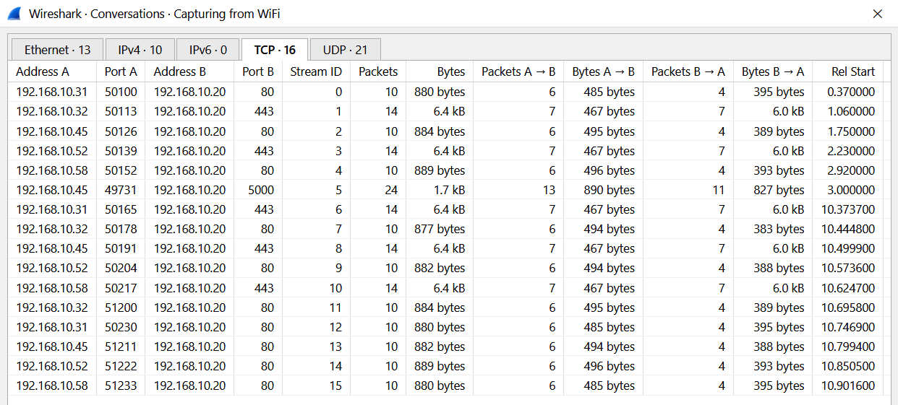
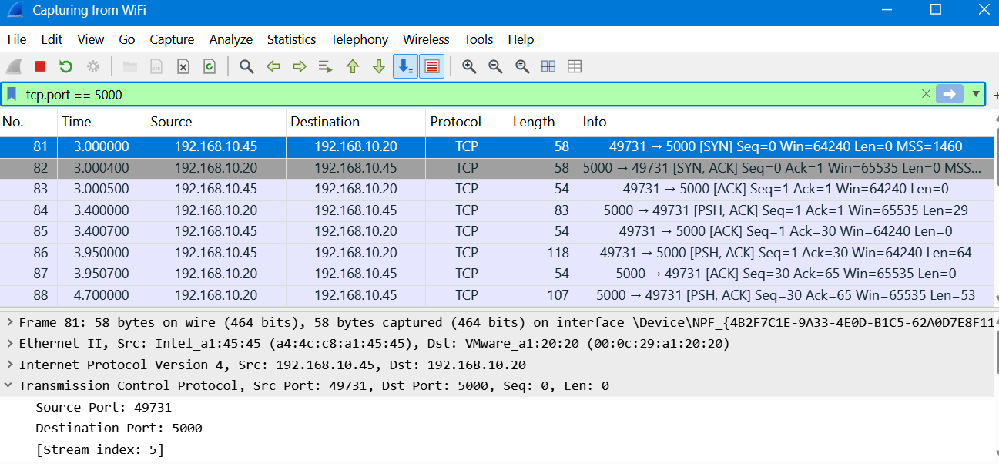

<!-- V2tWb1lXSnRVbGhoU0ZwTlltdEtjRnBYYXpWaFJYaFlUbGh3YTJKV1NqRlVSRXAzVFd4d1dWTnRNV3RXZWxaeldsVk5lRTVYU25SUFZ6QTk= -->

# &#76;&#97;&#98; 04 - &#70;&#111;&#108;&#108;&#111;&#119; &#84;&#67;&#80; &#83;&#116;&#114;&#101;&#97;&#109; 1

## &#79;&#98;&#106;&#101;&#99;&#116;&#105;&#118;&#101;

&#85;&#115;&#101; &#87;&#105;&#114;&#101;&#115;&#104;&#97;&#114;&#107;'&#115; &#70;&#111;&#108;&#108;&#111;&#119; &#84;&#67;&#80; &#83;&#116;&#114;&#101;&#97;&#109; &#102;&#101;&#97;&#116;&#117;&#114;&#101; &#116;&#111; &#114;&#101;&#99;&#111;&#110;&#115;&#116;&#114;&#117;&#99;&#116; &#97; &#84;&#67;&#80; &#99;&#111;&#110;&#118;&#101;&#114;&#115;&#97;&#116;&#105;&#111;&#110; &#97;&#110;&#100; &#105;&#110;&#115;&#112;&#101;&#99;&#116; &#116;&#104;&#101; &#116;&#114;&#97;&#110;&#115;&#109;&#105;&#116;&#116;&#101;&#100; &#100;&#97;&#116;&#97;.

## &#80;&#97;&#99;&#107;&#101;&#116; &#65;&#110;&#97;&#108;&#121;&#115;&#105;&#115;

### 1. &#72;&#111;&#119; &#109;&#97;&#110;&#121; &#112;&#97;&#99;&#107;&#101;&#116;&#115; &#100;&#105;&#100; &#87;&#105;&#114;&#101;&#115;&#104;&#97;&#114;&#107; &#99;&#97;&#112;&#116;&#117;&#114;&#101;?

&#67;&#104;&#101;&#99;&#107; &#116;&#104;&#101; &#116;&#111;&#116;&#97;&#108; &#112;&#97;&#99;&#107;&#101;&#116; &#99;&#111;&#117;&#110;&#116; &#105;&#110; &#87;&#105;&#114;&#101;&#115;&#104;&#97;&#114;&#107;.

**&#70;&#105;&#110;&#100;&#105;&#110;&#103;:** `246 packets`

### 2. &#87;&#104;&#105;&#99;&#104; &#84;&#67;&#80; &#112;&#111;&#114;&#116; &#105;&#115; &#117;&#115;&#101;&#100; &#98;&#121; &#116;&#104;&#101; &#112;&#108;&#97;&#105;&#110;-&#116;&#101;&#120;&#116; &#111;&#102;&#102;&#105;&#99;&#101; &#99;&#104;&#97;&#116; &#97;&#112;&#112;&#108;&#105;&#99;&#97;&#116;&#105;&#111;&#110;?

&#78;&#97;&#118;&#105;&#103;&#97;&#116;&#101; &#116;&#111; `Statistics → Conversations → TCP` &#97;&#110;&#100; &#105;&#110;&#115;&#112;&#101;&#99;&#116; &#116;&#104;&#101; &#84;&#67;&#80; &#99;&#111;&#110;&#118;&#101;&#114;&#115;&#97;&#116;&#105;&#111;&#110;&#115; &#116;&#111; &#105;&#100;&#101;&#110;&#116;&#105;&#102;&#121; &#116;&#104;&#101; &#110;&#111;&#110;-&#119;&#101;&#98; &#116;&#114;&#97;&#102;&#102;&#105;&#99;.



**&#70;&#105;&#110;&#100;&#105;&#110;&#103;:** `5000`

### 3. &#87;&#104;&#105;&#99;&#104; &#73;&#80; &#97;&#100;&#100;&#114;&#101;&#115;&#115; &#105;&#110;&#105;&#116;&#105;&#97;&#116;&#101;&#100; &#116;&#104;&#101; &#99;&#104;&#97;&#116; &#99;&#111;&#110;&#110;&#101;&#99;&#116;&#105;&#111;&#110;?

**&#68;&#105;&#115;&#112;&#108;&#97;&#121; &#102;&#105;&#108;&#116;&#101;&#114;:**
```wireshark
tcp.port == 5000
```


&#73;&#100;&#101;&#110;&#116;&#105;&#102;&#121; &#116;&#104;&#101; &#115;&#111;&#117;&#114;&#99;&#101; &#73;&#80; &#97;&#100;&#100;&#114;&#101;&#115;&#115; &#111;&#102; &#116;&#104;&#101; &#102;&#105;&#114;&#115;&#116; &#84;&#67;&#80; &#83;&#89;&#78; &#112;&#97;&#99;&#107;&#101;&#116;.

**&#70;&#105;&#110;&#100;&#105;&#110;&#103;:** `192.168.10.45`

### 4. &#87;&#104;&#97;&#116; &#105;&#115; &#116;&#104;&#101; &#84;&#67;&#80; &#115;&#116;&#114;&#101;&#97;&#109; &#110;&#117;&#109;&#98;&#101;&#114; &#111;&#102; &#116;&#104;&#101; &#99;&#104;&#97;&#116;?

&#82;&#105;&#103;&#104;&#116;-&#99;&#108;&#105;&#99;&#107; &#97; &#112;&#97;&#99;&#107;&#101;&#116; &#98;&#101;&#108;&#111;&#110;&#103;&#105;&#110;&#103; &#116;&#111; &#116;&#104;&#101; &#99;&#104;&#97;&#116; &#99;&#111;&#110;&#110;&#101;&#99;&#116;&#105;&#111;&#110; &#97;&#110;&#100; &#115;&#101;&#108;&#101;&#99;&#116; `Follow → TCP Stream`.

**&#70;&#105;&#110;&#100;&#105;&#110;&#103;:** `5`

> &#65;&#108;&#116;&#101;&#114;&#110;&#97;&#116;&#105;&#118;&#101;&#108;&#121;, &#105;&#100;&#101;&#110;&#116;&#105;&#102;&#121; &#116;&#104;&#101; &#115;&#111;&#117;&#114;&#99;&#101; &#73;&#80; &#97;&#100;&#100;&#114;&#101;&#115;&#115; &#111;&#102; &#116;&#104;&#101; &#102;&#105;&#114;&#115;&#116; &#84;&#67;&#80; &#83;&#89;&#78; &#112;&#97;&#99;&#107;&#101;&#116;, &#101;&#120;&#112;&#97;&#110;&#100; &#84;&#114;&#97;&#110;&#115;&#109;&#105;&#115;&#115;&#105;&#111;&#110; &#67;&#111;&#110;&#116;&#114;&#111;&#108; &#80;&#114;&#111;&#116;&#111;&#99;&#111;&#108;, &#97;&#110;&#100; &#99;&#104;&#101;&#99;&#107; &#116;&#104;&#101; &#83;&#116;&#114;&#101;&#97;&#109; &#105;&#110;&#100;&#101;&#120; &#102;&#105;&#101;&#108;&#100;.

### 5. &#72;&#111;&#119; &#109;&#97;&#110;&#121; &#98;&#121;&#116;&#101;&#115; &#100;&#111;&#101;&#115; &#116;&#104;&#101; &#101;&#110;&#116;&#105;&#114;&#101; &#99;&#111;&#110;&#118;&#101;&#114;&#115;&#97;&#116;&#105;&#111;&#110; &#99;&#111;&#110;&#116;&#97;&#105;&#110;?

&#67;&#104;&#101;&#99;&#107; &#116;&#104;&#101; &#98;&#121;&#116;&#101; &#99;&#111;&#117;&#110;&#116; &#100;&#105;&#115;&#112;&#108;&#97;&#121;&#101;&#100; &#97;&#116; &#116;&#104;&#101; &#98;&#111;&#116;&#116;&#111;&#109; &#111;&#102; &#116;&#104;&#101; &#70;&#111;&#108;&#108;&#111;&#119; &#84;&#67;&#80; &#83;&#116;&#114;&#101;&#97;&#109; &#119;&#105;&#110;&#100;&#111;&#119;.

**&#70;&#105;&#110;&#100;&#105;&#110;&#103;:** `413 bytes`

### 6. &#87;&#104;&#97;&#116; &#105;&#115; &#116;&#104;&#101; &#102;&#105;&#114;&#115;&#116; &#110;&#97;&#109;&#101; &#111;&#102; &#116;&#104;&#101; &#115;&#116;&#97;&#102;&#102; &#109;&#101;&#109;&#98;&#101;&#114; &#119;&#104;&#111; &#97;&#115;&#107;&#115; &#102;&#111;&#114; &#104;&#101;&#108;&#112;?

&#73;&#110;&#115;&#112;&#101;&#99;&#116; &#116;&#104;&#101; &#114;&#101;&#99;&#111;&#110;&#115;&#116;&#114;&#117;&#99;&#116;&#101;&#100; &#99;&#104;&#97;&#116; &#99;&#111;&#110;&#118;&#101;&#114;&#115;&#97;&#116;&#105;&#111;&#110;.

**&#70;&#105;&#110;&#100;&#105;&#110;&#103;:** `Ali`

### 7. &#87;&#104;&#105;&#99;&#104; &#115;&#104;&#97;&#114;&#101;&#100; &#100;&#114;&#105;&#118;&#101; &#99;&#111;&#117;&#108;&#100; &#116;&#104;&#101; &#115;&#116;&#97;&#102;&#102; &#109;&#101;&#109;&#98;&#101;&#114; &#110;&#111;&#116; &#111;&#112;&#101;&#110;?

&#73;&#110;&#115;&#112;&#101;&#99;&#116; &#116;&#104;&#101; &#99;&#104;&#97;&#116; &#109;&#101;&#115;&#115;&#97;&#103;&#101;&#115;.

**&#70;&#105;&#110;&#100;&#105;&#110;&#103;:** `Finance`

### 8. &#87;&#104;&#97;&#116; &#116;&#101;&#109;&#112;&#111;&#114;&#97;&#114;&#121; &#112;&#97;&#115;&#115;&#119;&#111;&#114;&#100; &#100;&#105;&#100; &#73;&#84; &#112;&#114;&#111;&#118;&#105;&#100;&#101;?

&#73;&#110;&#115;&#112;&#101;&#99;&#116; &#116;&#104;&#101; &#99;&#104;&#97;&#116; &#109;&#101;&#115;&#115;&#97;&#103;&#101;&#115;.

**&#70;&#105;&#110;&#100;&#105;&#110;&#103;:** `Tiger#4821`

### 9. &#87;&#104;&#97;&#116; &#105;&#115; &#116;&#104;&#101; &#103;&#117;&#101;&#115;&#116; &#87;&#105;-&#70;&#105; &#112;&#97;&#115;&#115;&#119;&#111;&#114;&#100;?

&#73;&#110;&#115;&#112;&#101;&#99;&#116; &#116;&#104;&#101; &#99;&#104;&#97;&#116; &#109;&#101;&#115;&#115;&#97;&#103;&#101;&#115;.

**&#70;&#105;&#110;&#100;&#105;&#110;&#103;:** `BlueHarbor77`

### 10. &#87;&#104;&#97;&#116; &#99;&#111;&#108;&#111;&#117;&#114; &#114;&#101;&#112;&#114;&#101;&#115;&#101;&#110;&#116;&#115; &#116;&#104;&#101; &#116;&#101;&#120;&#116; &#115;&#101;&#110;&#116; &#98;&#121; &#116;&#104;&#101; &#99;&#108;&#105;&#101;&#110;&#116; &#105;&#110; &#70;&#111;&#108;&#108;&#111;&#119; &#84;&#67;&#80; &#83;&#116;&#114;&#101;&#97;&#109;?

**&#70;&#105;&#110;&#100;&#105;&#110;&#103;:** `Red`

> &#73;&#110; &#87;&#105;&#114;&#101;&#115;&#104;&#97;&#114;&#107;'&#115; &#100;&#101;&#102;&#97;&#117;&#108;&#116; &#70;&#111;&#108;&#108;&#111;&#119; &#84;&#67;&#80; &#83;&#116;&#114;&#101;&#97;&#109; &#99;&#111;&#108;&#111;&#117;&#114; &#115;&#99;&#104;&#101;&#109;&#101;, &#114;&#101;&#100; &#114;&#101;&#112;&#114;&#101;&#115;&#101;&#110;&#116;&#115; &#100;&#97;&#116;&#97; &#115;&#101;&#110;&#116; &#98;&#121; &#116;&#104;&#101; &#99;&#108;&#105;&#101;&#110;&#116;, &#119;&#104;&#105;&#108;&#101; &#98;&#108;&#117;&#101; &#114;&#101;&#112;&#114;&#101;&#115;&#101;&#110;&#116;&#115; &#100;&#97;&#116;&#97; &#115;&#101;&#110;&#116; &#98;&#121; &#116;&#104;&#101; &#115;&#101;&#114;&#118;&#101;&#114;.

## &#76;&#101;&#115;&#115;&#111;&#110;&#115; &#76;&#101;&#97;&#114;&#110;&#101;&#100;

- &#70;&#111;&#108;&#108;&#111;&#119; &#84;&#67;&#80; &#83;&#116;&#114;&#101;&#97;&#109; &#114;&#101;&#99;&#111;&#110;&#115;&#116;&#114;&#117;&#99;&#116;&#115; &#84;&#67;&#80; &#99;&#111;&#110;&#118;&#101;&#114;&#115;&#97;&#116;&#105;&#111;&#110;&#115; &#105;&#110;&#116;&#111; &#97; &#114;&#101;&#97;&#100;&#97;&#98;&#108;&#101; &#115;&#101;&#113;&#117;&#101;&#110;&#99;&#101;, &#109;&#97;&#107;&#105;&#110;&#103; &#97;&#112;&#112;&#108;&#105;&#99;&#97;&#116;&#105;&#111;&#110;-&#108;&#101;&#118;&#101;&#108; &#99;&#111;&#109;&#109;&#117;&#110;&#105;&#99;&#97;&#116;&#105;&#111;&#110; &#101;&#97;&#115;&#105;&#101;&#114; &#116;&#111; &#105;&#110;&#115;&#112;&#101;&#99;&#116;.
- &#85;&#110;&#101;&#110;&#99;&#114;&#121;&#112;&#116;&#101;&#100; &#112;&#114;&#111;&#116;&#111;&#99;&#111;&#108;&#115; &#99;&#97;&#110; &#101;&#120;&#112;&#111;&#115;&#101; &#115;&#101;&#110;&#115;&#105;&#116;&#105;&#118;&#101; &#105;&#110;&#102;&#111;&#114;&#109;&#97;&#116;&#105;&#111;&#110;, &#105;&#110;&#99;&#108;&#117;&#100;&#105;&#110;&#103; &#117;&#115;&#101;&#114;&#110;&#97;&#109;&#101;&#115;, &#116;&#101;&#109;&#112;&#111;&#114;&#97;&#114;&#121; &#112;&#97;&#115;&#115;&#119;&#111;&#114;&#100;&#115;, &#97;&#110;&#100; &#110;&#101;&#116;&#119;&#111;&#114;&#107; &#99;&#114;&#101;&#100;&#101;&#110;&#116;&#105;&#97;&#108;&#115;.
- &#84;&#104;&#101; &#102;&#105;&#114;&#115;&#116; &#84;&#67;&#80; &#83;&#89;&#78; &#112;&#97;&#99;&#107;&#101;&#116; &#105;&#100;&#101;&#110;&#116;&#105;&#102;&#105;&#101;&#115; &#116;&#104;&#101; &#99;&#108;&#105;&#101;&#110;&#116; &#116;&#104;&#97;&#116; &#105;&#110;&#105;&#116;&#105;&#97;&#116;&#101;&#100; &#97; &#99;&#111;&#110;&#110;&#101;&#99;&#116;&#105;&#111;&#110;.
- &#84;&#67;&#80; &#115;&#116;&#114;&#101;&#97;&#109; &#110;&#117;&#109;&#98;&#101;&#114;&#115; &#104;&#101;&#108;&#112; &#105;&#115;&#111;&#108;&#97;&#116;&#101; &#105;&#110;&#100;&#105;&#118;&#105;&#100;&#117;&#97;&#108; &#99;&#111;&#110;&#118;&#101;&#114;&#115;&#97;&#116;&#105;&#111;&#110;&#115; &#119;&#105;&#116;&#104;&#105;&#110; &#97; &#80;&#67;&#65;&#80; &#102;&#105;&#108;&#101;.
- &#87;&#105;&#114;&#101;&#115;&#104;&#97;&#114;&#107; &#117;&#115;&#101;&#115; &#100;&#105;&#102;&#102;&#101;&#114;&#101;&#110;&#116; &#99;&#111;&#108;&#111;&#117;&#114;&#115; &#116;&#111; &#100;&#105;&#115;&#116;&#105;&#110;&#103;&#117;&#105;&#115;&#104; &#100;&#97;&#116;&#97; &#115;&#101;&#110;&#116; &#98;&#121; &#116;&#104;&#101; &#99;&#108;&#105;&#101;&#110;&#116; &#97;&#110;&#100; &#115;&#101;&#114;&#118;&#101;&#114; &#105;&#110; &#70;&#111;&#108;&#108;&#111;&#119; &#84;&#67;&#80; &#83;&#116;&#114;&#101;&#97;&#109;.

---

<div align="center">
  <sub> &#67;&#114;&#101;&#97;&#116;&#101;&#100; &#98;&#121; <a href="https://github.com/n-afiqa/">@&#110;-&#97;&#102;&#105;&#113;&#97;</a> · © 2026</sub>
</div>
