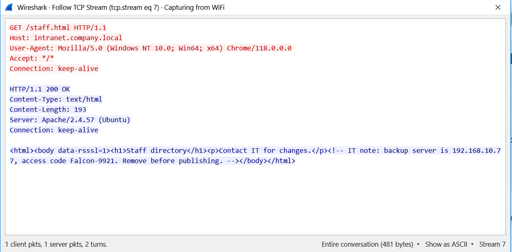
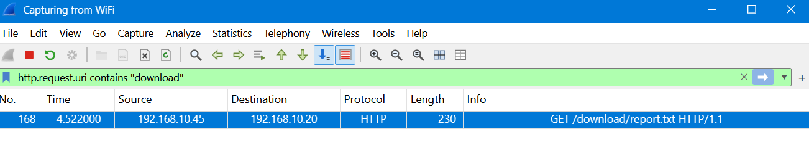
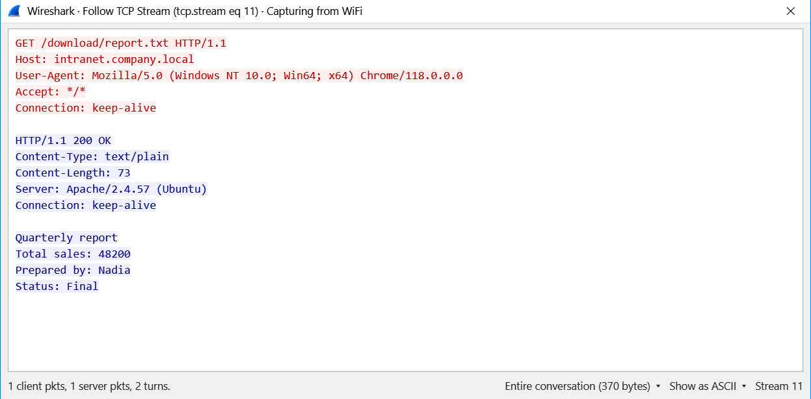

<!-- V2tWb1lXSnRVbGhoU0ZwTlltdEtjRnBYYXpWaFJYaFlUbGh3YTJKV1NqRlVSRXAzVFd4d1dWTnRNV3RXZWxaeldsVk5lRTVYU25SUFZ6QTk= -->

# &#76;&#97;&#98; 05 - &#70;&#111;&#108;&#108;&#111;&#119; &#84;&#67;&#80; &#83;&#116;&#114;&#101;&#97;&#109; 2

## &#79;&#98;&#106;&#101;&#99;&#116;&#105;&#118;&#101;

&#65;&#110;&#97;&#108;&#121;&#122;&#101; &#72;&#84;&#84;&#80; &#116;&#114;&#97;&#102;&#102;&#105;&#99; &#117;&#115;&#105;&#110;&#103; &#87;&#105;&#114;&#101;&#115;&#104;&#97;&#114;&#107;'&#115; &#70;&#111;&#108;&#108;&#111;&#119; &#84;&#67;&#80; &#83;&#116;&#114;&#101;&#97;&#109; &#102;&#101;&#97;&#116;&#117;&#114;&#101; &#116;&#111; &#105;&#110;&#115;&#112;&#101;&#99;&#116; &#119;&#101;&#98; &#112;&#97;&#103;&#101; &#99;&#111;&#110;&#116;&#101;&#110;&#116;, &#105;&#100;&#101;&#110;&#116;&#105;&#102;&#121; &#104;&#105;&#100;&#100;&#101;&#110; &#105;&#110;&#102;&#111;&#114;&#109;&#97;&#116;&#105;&#111;&#110;, &#97;&#110;&#100; &#101;&#120;&#97;&#109;&#105;&#110;&#101; &#100;&#111;&#119;&#110;&#108;&#111;&#97;&#100;&#101;&#100; &#102;&#105;&#108;&#101;&#115;.

## &#80;&#97;&#99;&#107;&#101;&#116; &#65;&#110;&#97;&#108;&#121;&#115;&#105;&#115;

### 1. &#72;&#111;&#119; &#109;&#97;&#110;&#121; &#112;&#97;&#99;&#107;&#101;&#116;&#115; &#100;&#105;&#100; &#87;&#105;&#114;&#101;&#115;&#104;&#97;&#114;&#107; &#99;&#97;&#112;&#116;&#117;&#114;&#101;?

&#67;&#104;&#101;&#99;&#107; &#116;&#104;&#101; &#116;&#111;&#116;&#97;&#108; &#112;&#97;&#99;&#107;&#101;&#116; &#99;&#111;&#117;&#110;&#116; &#105;&#110; &#87;&#105;&#114;&#101;&#115;&#104;&#97;&#114;&#107;.

**&#70;&#105;&#110;&#100;&#105;&#110;&#103;:** `282 packets`

### 2. &#87;&#104;&#105;&#99;&#104; &#105;&#110;&#116;&#114;&#97;&#110;&#101;&#116; &#112;&#97;&#103;&#101; &#99;&#111;&#110;&#116;&#97;&#105;&#110;&#115; &#97; &#104;&#105;&#100;&#100;&#101;&#110; &#110;&#111;&#116;&#101;?

**&#68;&#105;&#115;&#112;&#108;&#97;&#121; &#102;&#105;&#108;&#116;&#101;&#114;:**
```wireshark
http
```

&#70;&#111;&#108;&#108;&#111;&#119; &#116;&#104;&#101; &#84;&#67;&#80; &#115;&#116;&#114;&#101;&#97;&#109;&#115; &#99;&#111;&#110;&#116;&#97;&#105;&#110;&#105;&#110;&#103; &#72;&#84;&#84;&#80; &#116;&#114;&#97;&#102;&#102;&#105;&#99; &#97;&#110;&#100; &#105;&#110;&#115;&#112;&#101;&#99;&#116; &#116;&#104;&#101; &#114;&#101;&#113;&#117;&#101;&#115;&#116;&#101;&#100; &#112;&#97;&#103;&#101; &#112;&#97;&#116;&#104;&#115;.

**&#70;&#105;&#110;&#100;&#105;&#110;&#103;:** `/staff.html`

### 3. &#87;&#104;&#101;&#114;&#101; &#105;&#115; &#116;&#104;&#101; &#104;&#105;&#100;&#100;&#101;&#110; &#110;&#111;&#116;&#101; &#108;&#111;&#99;&#97;&#116;&#101;&#100;?

&#73;&#110;&#115;&#112;&#101;&#99;&#116; &#116;&#104;&#101; &#72;&#84;&#77;&#76; &#114;&#101;&#115;&#112;&#111;&#110;&#115;&#101; &#98;&#111;&#100;&#121; &#105;&#110; &#116;&#104;&#101; &#70;&#111;&#108;&#108;&#111;&#119; &#84;&#67;&#80; &#83;&#116;&#114;&#101;&#97;&#109; &#119;&#105;&#110;&#100;&#111;&#119;.



**&#70;&#105;&#110;&#100;&#105;&#110;&#103;:** &#72;&#84;&#77;&#76; &#99;&#111;&#109;&#109;&#101;&#110;&#116; (`<!-- -->`)

### 4. &#87;&#104;&#105;&#99;&#104; &#84;&#67;&#80; &#115;&#116;&#114;&#101;&#97;&#109; &#110;&#117;&#109;&#98;&#101;&#114; &#99;&#97;&#114;&#114;&#105;&#101;&#115; &#116;&#104;&#101; `/staff.html` &#112;&#97;&#103;&#101;?

&#73;&#110;&#115;&#112;&#101;&#99;&#116; &#116;&#104;&#101; &#84;&#67;&#80; &#115;&#116;&#114;&#101;&#97;&#109; &#105;&#110;&#100;&#101;&#120; &#111;&#102; &#116;&#104;&#101; &#99;&#111;&#114;&#114;&#101;&#115;&#112;&#111;&#110;&#100;&#105;&#110;&#103; &#72;&#84;&#84;&#80; &#99;&#111;&#110;&#118;&#101;&#114;&#115;&#97;&#116;&#105;&#111;&#110;.

**&#70;&#105;&#110;&#100;&#105;&#110;&#103;:** `7`

### 5. &#87;&#104;&#97;&#116; &#105;&#115; &#116;&#104;&#101; &#97;&#99;&#99;&#101;&#115;&#115; &#99;&#111;&#100;&#101; &#119;&#111;&#114;&#100; &#105;&#110; &#116;&#104;&#101; &#104;&#105;&#100;&#100;&#101;&#110; &#110;&#111;&#116;&#101;?

&#73;&#110;&#115;&#112;&#101;&#99;&#116; &#116;&#104;&#101; &#72;&#84;&#77;&#76; &#99;&#111;&#109;&#109;&#101;&#110;&#116; &#105;&#110; &#116;&#104;&#101; &#115;&#101;&#114;&#118;&#101;&#114; &#114;&#101;&#115;&#112;&#111;&#110;&#115;&#101;.

**&#70;&#105;&#110;&#100;&#105;&#110;&#103;:** `Falcon-9921`

### 6. &#87;&#104;&#97;&#116; &#105;&#115; &#116;&#104;&#101; &#73;&#80; &#97;&#100;&#100;&#114;&#101;&#115;&#115; &#111;&#102; &#116;&#104;&#101; &#98;&#97;&#99;&#107;&#117;&#112; &#115;&#101;&#114;&#118;&#101;&#114; &#109;&#101;&#110;&#116;&#105;&#111;&#110;&#101;&#100; &#105;&#110; &#116;&#104;&#101; &#110;&#111;&#116;&#101;?

&#73;&#110;&#115;&#112;&#101;&#99;&#116; &#116;&#104;&#101; &#104;&#105;&#100;&#100;&#101;&#110; &#110;&#111;&#116;&#101; &#105;&#110; &#116;&#104;&#101; &#72;&#84;&#77;&#76; &#99;&#111;&#109;&#109;&#101;&#110;&#116; &#105;&#110; &#116;&#104;&#101; &#114;&#101;&#115;&#112;&#111;&#110;&#115;&#101; &#98;&#111;&#100;&#121;.

**&#70;&#105;&#110;&#100;&#105;&#110;&#103;:** `192.168.10.77`

### 7. &#87;&#104;&#105;&#99;&#104; &#100;&#105;&#114;&#101;&#99;&#116;&#105;&#111;&#110; &#100;&#105;&#100; &#116;&#104;&#101; &#98;&#108;&#117;&#101; &#116;&#101;&#120;&#116; &#116;&#114;&#97;&#118;&#101;&#108; &#105;&#110; &#70;&#111;&#108;&#108;&#111;&#119; &#84;&#67;&#80; &#83;&#116;&#114;&#101;&#97;&#109;?

&#84;&#104;&#101; &#104;&#105;&#100;&#100;&#101;&#110; &#110;&#111;&#116;&#101; &#97;&#112;&#112;&#101;&#97;&#114;&#115; &#105;&#110; &#116;&#104;&#101; &#72;&#84;&#84;&#80; &#114;&#101;&#115;&#112;&#111;&#110;&#115;&#101; &#98;&#111;&#100;&#121;.

**&#70;&#105;&#110;&#100;&#105;&#110;&#103;:** &#83;&#101;&#114;&#118;&#101;&#114; &#116;&#111; &#67;&#108;&#105;&#101;&#110;&#116;

### 8. &#87;&#104;&#97;&#116; &#72;&#84;&#84;&#80; &#115;&#116;&#97;&#116;&#117;&#115; &#99;&#111;&#100;&#101; &#100;&#105;&#100; &#116;&#104;&#101; &#115;&#101;&#114;&#118;&#101;&#114; &#115;&#101;&#110;&#100; &#102;&#111;&#114; `/staff.html`?

&#73;&#110;&#115;&#112;&#101;&#99;&#116; &#116;&#104;&#101; &#72;&#84;&#84;&#80; &#114;&#101;&#115;&#112;&#111;&#110;&#115;&#101; &#115;&#116;&#97;&#116;&#117;&#115; &#108;&#105;&#110;&#101;.

**&#70;&#105;&#110;&#100;&#105;&#110;&#103;:** `200 OK`

### 9. &#87;&#104;&#97;&#116; &#105;&#115; &#116;&#104;&#101; &#110;&#97;&#109;&#101; &#111;&#102; &#116;&#104;&#101; &#112;&#108;&#97;&#105;&#110;-&#116;&#101;&#120;&#116; &#102;&#105;&#108;&#101; &#100;&#111;&#119;&#110;&#108;&#111;&#97;&#100;&#101;&#100; &#102;&#114;&#111;&#109; &#116;&#104;&#101; `/download/` &#102;&#111;&#108;&#100;&#101;&#114;?

**&#68;&#105;&#115;&#112;&#108;&#97;&#121; &#102;&#105;&#108;&#116;&#101;&#114;:**
```wireshark
http.request.uri contains "download"
```


&#73;&#110;&#115;&#112;&#101;&#99;&#116; &#116;&#104;&#101; &#72;&#84;&#84;&#80; &#114;&#101;&#113;&#117;&#101;&#115;&#116; &#85;&#82;&#73;.

**&#70;&#105;&#110;&#100;&#105;&#110;&#103;:** `report.txt`

### 10. &#87;&#104;&#111; &#112;&#114;&#101;&#112;&#97;&#114;&#101;&#100; &#116;&#104;&#101; &#100;&#111;&#119;&#110;&#108;&#111;&#97;&#100;&#101;&#100; &#114;&#101;&#112;&#111;&#114;&#116;?

&#70;&#111;&#108;&#108;&#111;&#119; &#116;&#104;&#101; &#84;&#67;&#80; &#115;&#116;&#114;&#101;&#97;&#109; &#97;&#115;&#115;&#111;&#99;&#105;&#97;&#116;&#101;&#100; &#119;&#105;&#116;&#104; `report.txt` &#97;&#110;&#100; &#105;&#110;&#115;&#112;&#101;&#99;&#116; &#105;&#116;&#115; &#99;&#111;&#110;&#116;&#101;&#110;&#116;&#115;.



**&#70;&#105;&#110;&#100;&#105;&#110;&#103;:** `Nadia`

## &#76;&#101;&#115;&#115;&#111;&#110;&#115; &#76;&#101;&#97;&#114;&#110;&#101;&#100;

- &#85;&#110;&#100;&#101;&#114;&#115;&#116;&#97;&#110;&#100;&#105;&#110;&#103; &#119;&#101;&#98; &#116;&#101;&#99;&#104;&#110;&#111;&#108;&#111;&#103;&#105;&#101;&#115; &#105;&#115; &#101;&#115;&#115;&#101;&#110;&#116;&#105;&#97;&#108; &#102;&#111;&#114; &#97;&#110;&#97;&#108;&#121;&#122;&#105;&#110;&#103; &#72;&#84;&#84;&#80; &#99;&#111;&#109;&#109;&#117;&#110;&#105;&#99;&#97;&#116;&#105;&#111;&#110;, &#105;&#110;&#116;&#101;&#114;&#112;&#114;&#101;&#116;&#105;&#110;&#103; &#72;&#84;&#77;&#76; &#115;&#116;&#114;&#117;&#99;&#116;&#117;&#114;&#101;, &#97;&#110;&#100; &#105;&#100;&#101;&#110;&#116;&#105;&#102;&#121;&#105;&#110;&#103; &#112;&#111;&#116;&#101;&#110;&#116;&#105;&#97;&#108; &#105;&#110;&#102;&#111;&#114;&#109;&#97;&#116;&#105;&#111;&#110; &#101;&#120;&#112;&#111;&#115;&#117;&#114;&#101;.
- &#72;&#84;&#84;&#80; &#114;&#101;&#113;&#117;&#101;&#115;&#116;&#115;, &#114;&#101;&#115;&#112;&#111;&#110;&#115;&#101;&#115;, &#97;&#110;&#100; &#115;&#116;&#97;&#116;&#117;&#115; &#99;&#111;&#100;&#101;&#115; &#104;&#101;&#108;&#112; &#101;&#120;&#112;&#108;&#97;&#105;&#110; &#104;&#111;&#119; &#99;&#108;&#105;&#101;&#110;&#116;&#115; &#97;&#110;&#100; &#119;&#101;&#98; &#115;&#101;&#114;&#118;&#101;&#114;&#115; &#99;&#111;&#109;&#109;&#117;&#110;&#105;&#99;&#97;&#116;&#101;.
- &#70;&#111;&#108;&#108;&#111;&#119; &#84;&#67;&#80; &#83;&#116;&#114;&#101;&#97;&#109; &#99;&#97;&#110; &#114;&#101;&#99;&#111;&#110;&#115;&#116;&#114;&#117;&#99;&#116; &#72;&#84;&#84;&#80; &#99;&#111;&#110;&#118;&#101;&#114;&#115;&#97;&#116;&#105;&#111;&#110;&#115; &#97;&#110;&#100; &#114;&#101;&#118;&#101;&#97;&#108; &#99;&#111;&#110;&#116;&#101;&#110;&#116; &#110;&#111;&#116; &#100;&#105;&#115;&#112;&#108;&#97;&#121;&#101;&#100; &#105;&#110; &#97; &#98;&#114;&#111;&#119;&#115;&#101;&#114;.
- &#72;&#84;&#77;&#76; &#99;&#111;&#109;&#109;&#101;&#110;&#116;&#115; &#97;&#114;&#101; &#112;&#97;&#114;&#116; &#111;&#102; &#116;&#104;&#101; &#112;&#97;&#103;&#101; &#115;&#111;&#117;&#114;&#99;&#101; &#98;&#117;&#116; &#97;&#114;&#101; &#110;&#111;&#116; &#114;&#101;&#110;&#100;&#101;&#114;&#101;&#100; &#105;&#110; &#116;&#104;&#101; &#98;&#114;&#111;&#119;&#115;&#101;&#114;, &#109;&#97;&#107;&#105;&#110;&#103; &#116;&#104;&#101;&#109; &#97; &#112;&#111;&#116;&#101;&#110;&#116;&#105;&#97;&#108; &#108;&#111;&#99;&#97;&#116;&#105;&#111;&#110; &#102;&#111;&#114; &#104;&#105;&#100;&#100;&#101;&#110; &#105;&#110;&#102;&#111;&#114;&#109;&#97;&#116;&#105;&#111;&#110;.
- &#72;&#84;&#84;&#80; &#114;&#101;&#115;&#112;&#111;&#110;&#115;&#101; &#98;&#111;&#100;&#105;&#101;&#115; &#97;&#110;&#100; &#100;&#111;&#119;&#110;&#108;&#111;&#97;&#100;&#101;&#100; &#102;&#105;&#108;&#101;&#115; &#116;&#114;&#97;&#110;&#115;&#109;&#105;&#116;&#116;&#101;&#100; &#111;&#118;&#101;&#114; &#117;&#110;&#101;&#110;&#99;&#114;&#121;&#112;&#116;&#101;&#100; &#99;&#111;&#110;&#110;&#101;&#99;&#116;&#105;&#111;&#110;&#115; &#99;&#97;&#110; &#101;&#120;&#112;&#111;&#115;&#101; &#115;&#101;&#110;&#115;&#105;&#116;&#105;&#118;&#101; &#105;&#110;&#102;&#111;&#114;&#109;&#97;&#116;&#105;&#111;&#110;.
- &#70;&#105;&#108;&#116;&#101;&#114;&#105;&#110;&#103; &#72;&#84;&#84;&#80; &#114;&#101;&#113;&#117;&#101;&#115;&#116; &#85;&#82;&#73;&#115; &#104;&#101;&#108;&#112;&#115; &#105;&#100;&#101;&#110;&#116;&#105;&#102;&#121; &#115;&#112;&#101;&#99;&#105;&#102;&#105;&#99; &#114;&#101;&#115;&#111;&#117;&#114;&#99;&#101;&#115; &#114;&#101;&#113;&#117;&#101;&#115;&#116;&#101;&#100; &#98;&#121; &#97; &#99;&#108;&#105;&#101;&#110;&#116;.

---

<div align="center">
  <sub> &#67;&#114;&#101;&#97;&#116;&#101;&#100; &#98;&#121; <a href="https://github.com/n-afiqa/">@&#110;-&#97;&#102;&#105;&#113;&#97;</a> · © 2026</sub>
</div>
