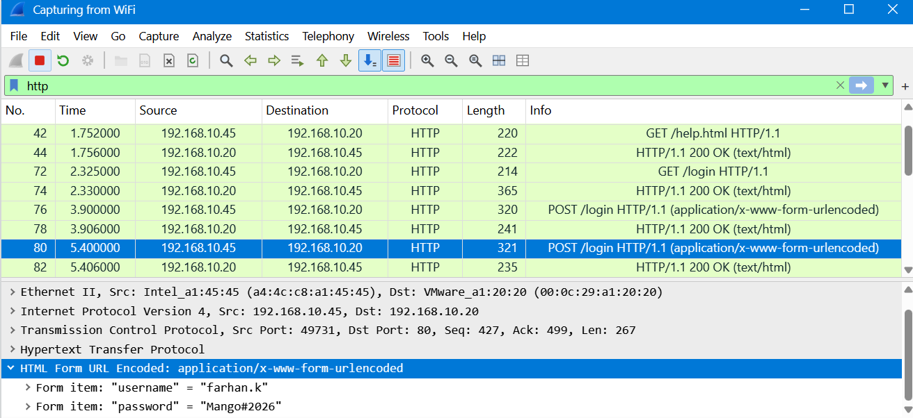

<!-- V2tWb1lXSnRVbGhoU0ZwTlltdEtjRnBYYXpWaFJYaFlUbGh3YTJKV1NqRlVSRXAzVFd4d1dWTnRNV3RXZWxaeldsVk5lRTVYU25SUFZ6QTk= -->

# &#76;&#97;&#98; 06 - &#72;&#84;&#84;&#80; &#80;&#108;&#97;&#105;&#110; &#84;&#101;&#120;&#116; &#67;&#114;&#101;&#100;&#101;&#110;&#116;&#105;&#97;&#108;&#115;

## &#79;&#98;&#106;&#101;&#99;&#116;&#105;&#118;&#101;

&#65;&#110;&#97;&#108;&#121;&#122;&#101; &#72;&#84;&#84;&#80; &#116;&#114;&#97;&#102;&#102;&#105;&#99; &#116;&#111; &#105;&#100;&#101;&#110;&#116;&#105;&#102;&#121; &#117;&#115;&#101;&#114;&#110;&#97;&#109;&#101;&#115; &#97;&#110;&#100; &#112;&#97;&#115;&#115;&#119;&#111;&#114;&#100;&#115; &#116;&#114;&#97;&#110;&#115;&#109;&#105;&#116;&#116;&#101;&#100; &#105;&#110; &#99;&#108;&#101;&#97;&#114; &#116;&#101;&#120;&#116; &#100;&#117;&#114;&#105;&#110;&#103; &#97; &#119;&#101;&#98; &#112;&#111;&#114;&#116;&#97;&#108; &#108;&#111;&#103;&#105;&#110;.

## &#80;&#97;&#99;&#107;&#101;&#116; &#65;&#110;&#97;&#108;&#121;&#115;&#105;&#115;

### 1. &#72;&#111;&#119; &#109;&#97;&#110;&#121; &#112;&#97;&#99;&#107;&#101;&#116;&#115; &#100;&#105;&#100; &#87;&#105;&#114;&#101;&#115;&#104;&#97;&#114;&#107; &#99;&#97;&#112;&#116;&#117;&#114;&#101;?

&#67;&#104;&#101;&#99;&#107; &#116;&#104;&#101; &#116;&#111;&#116;&#97;&#108; &#112;&#97;&#99;&#107;&#101;&#116; &#99;&#111;&#117;&#110;&#116; &#105;&#110; &#87;&#105;&#114;&#101;&#115;&#104;&#97;&#114;&#107;.

**&#70;&#105;&#110;&#100;&#105;&#110;&#103;:** `255 packets`

### 2. &#87;&#104;&#105;&#99;&#104; &#112;&#114;&#111;&#116;&#111;&#99;&#111;&#108; &#99;&#97;&#114;&#114;&#105;&#101;&#100; &#116;&#104;&#101; &#115;&#105;&#103;&#110;-&#105;&#110;?

**&#68;&#105;&#115;&#112;&#108;&#97;&#121; &#102;&#105;&#108;&#116;&#101;&#114;:**
```wireshark
http
```

**&#70;&#105;&#110;&#100;&#105;&#110;&#103;:** `HTTP`

### 3. &#87;&#104;&#105;&#99;&#104; &#72;&#84;&#84;&#80; &#109;&#101;&#116;&#104;&#111;&#100; &#100;&#105;&#100; &#116;&#104;&#101; &#115;&#105;&#103;&#110;-&#105;&#110; &#102;&#111;&#114;&#109; &#117;&#115;&#101;?

&#73;&#110;&#115;&#112;&#101;&#99;&#116; &#116;&#104;&#101; &#72;&#84;&#84;&#80; &#114;&#101;&#113;&#117;&#101;&#115;&#116; &#109;&#101;&#116;&#104;&#111;&#100; &#105;&#110; &#116;&#104;&#101; &#108;&#111;&#103;&#105;&#110; &#112;&#97;&#99;&#107;&#101;&#116;.

**&#70;&#105;&#110;&#100;&#105;&#110;&#103;:** `POST`

### 4. &#87;&#104;&#105;&#99;&#104; &#112;&#97;&#103;&#101; &#112;&#97;&#116;&#104; &#114;&#101;&#99;&#101;&#105;&#118;&#101;&#100; &#116;&#104;&#101; &#108;&#111;&#103;&#105;&#110; &#102;&#111;&#114;&#109; &#115;&#117;&#98;&#109;&#105;&#115;&#115;&#105;&#111;&#110;?

&#73;&#110;&#115;&#112;&#101;&#99;&#116; &#116;&#104;&#101; &#72;&#84;&#84;&#80; &#114;&#101;&#113;&#117;&#101;&#115;&#116; &#85;&#82;&#73;.

**&#70;&#105;&#110;&#100;&#105;&#110;&#103;:** `/login`

### 5. &#87;&#104;&#105;&#99;&#104; &#80;&#67; &#115;&#101;&#110;&#116; &#116;&#104;&#101; &#115;&#105;&#103;&#110;-&#105;&#110; &#114;&#101;&#113;&#117;&#101;&#115;&#116;?

&#73;&#110;&#115;&#112;&#101;&#99;&#116; &#116;&#104;&#101; &#115;&#111;&#117;&#114;&#99;&#101; &#73;&#80; &#97;&#100;&#100;&#114;&#101;&#115;&#115; &#111;&#102; &#116;&#104;&#101; &#72;&#84;&#84;&#80; &#80;&#79;&#83;&#84; &#112;&#97;&#99;&#107;&#101;&#116;.

**&#70;&#105;&#110;&#100;&#105;&#110;&#103;:** `192.168.10.45`

### 6. &#72;&#111;&#119; &#109;&#97;&#110;&#121; &#116;&#105;&#109;&#101;&#115; &#100;&#105;&#100; &#116;&#104;&#101; &#117;&#115;&#101;&#114; &#115;&#117;&#98;&#109;&#105;&#116; &#116;&#104;&#101; &#115;&#105;&#103;&#110;-&#105;&#110; &#102;&#111;&#114;&#109;?

**&#68;&#105;&#115;&#112;&#108;&#97;&#121; &#102;&#105;&#108;&#116;&#101;&#114;:**
```wireshark
http.request.method == "POST"
```

**&#70;&#105;&#110;&#100;&#105;&#110;&#103;:** `2 submissions`

>&#65;&#108;&#116;&#101;&#114;&#110;&#97;&#116;&#105;&#118;&#101;&#108;&#121;, &#105;&#110;&#115;&#112;&#101;&#99;&#116; &#116;&#104;&#101; &#110;&#117;&#109;&#98;&#101;&#114; &#111;&#102; &#80;&#79;&#83;&#84; &#114;&#101;&#113;&#117;&#101;&#115;&#116;&#115; &#115;&#101;&#110;&#116; &#116;&#111; &#116;&#104;&#101; &#108;&#111;&#103;&#105;&#110; &#101;&#110;&#100;&#112;&#111;&#105;&#110;&#116;.

### 7. &#87;&#104;&#97;&#116; &#117;&#115;&#101;&#114;&#110;&#97;&#109;&#101; &#119;&#97;&#115; &#115;&#117;&#98;&#109;&#105;&#116;&#116;&#101;&#100;?

&#83;&#101;&#108;&#101;&#99;&#116; &#97; &#80;&#79;&#83;&#84; &#112;&#97;&#99;&#107;&#101;&#116; &#97;&#110;&#100; &#101;&#120;&#112;&#97;&#110;&#100; `HTML Form URL Encoded` &#105;&#110; &#116;&#104;&#101; &#112;&#97;&#99;&#107;&#101;&#116; &#100;&#101;&#116;&#97;&#105;&#108;&#115;.



**&#70;&#105;&#110;&#100;&#105;&#110;&#103;:** `farhan.k`

> &#65;&#108;&#116;&#101;&#114;&#110;&#97;&#116;&#105;&#118;&#101;&#108;&#121;, &#117;&#115;&#101; &#70;&#111;&#108;&#108;&#111;&#119; → &#84;&#67;&#80; &#83;&#116;&#114;&#101;&#97;&#109; &#116;&#111; &#105;&#110;&#115;&#112;&#101;&#99;&#116; &#116;&#104;&#101; &#72;&#84;&#84;&#80; &#80;&#79;&#83;&#84; &#114;&#101;&#113;&#117;&#101;&#115;&#116; &#97;&#110;&#100; &#108;&#111;&#99;&#97;&#116;&#101; &#116;&#104;&#101; &#115;&#117;&#98;&#109;&#105;&#116;&#116;&#101;&#100; &#117;&#115;&#101;&#114;&#110;&#97;&#109;&#101; &#105;&#110; &#116;&#104;&#101; &#114;&#101;&#113;&#117;&#101;&#115;&#116; &#98;&#111;&#100;&#121;.

### 8. &#87;&#104;&#97;&#116; &#112;&#97;&#115;&#115;&#119;&#111;&#114;&#100; &#100;&#105;&#100; &#116;&#104;&#101; &#117;&#115;&#101;&#114; &#101;&#110;&#116;&#101;&#114; &#100;&#117;&#114;&#105;&#110;&#103; &#116;&#104;&#101; &#115;&#117;&#99;&#99;&#101;&#115;&#115;&#102;&#117;&#108; &#115;&#101;&#99;&#111;&#110;&#100; &#108;&#111;&#103;&#105;&#110;?

&#73;&#110;&#115;&#112;&#101;&#99;&#116; &#116;&#104;&#101; &#115;&#101;&#99;&#111;&#110;&#100; &#80;&#79;&#83;&#84; &#114;&#101;&#113;&#117;&#101;&#115;&#116; &#97;&#110;&#100; &#101;&#120;&#112;&#97;&#110;&#100; `HTML Form URL Encoded` &#116;&#111; &#108;&#111;&#99;&#97;&#116;&#101; &#116;&#104;&#101; &#112;&#97;&#115;&#115;&#119;&#111;&#114;&#100; &#102;&#105;&#101;&#108;&#100;.

**&#70;&#105;&#110;&#100;&#105;&#110;&#103;:** `Mango#2026`

> &#65;&#108;&#116;&#101;&#114;&#110;&#97;&#116;&#105;&#118;&#101;&#108;&#121;, &#117;&#115;&#101; &#70;&#111;&#108;&#108;&#111;&#119; → &#84;&#67;&#80; &#83;&#116;&#114;&#101;&#97;&#109; &#116;&#111; &#105;&#110;&#115;&#112;&#101;&#99;&#116; &#116;&#104;&#101; &#72;&#84;&#84;&#80; &#80;&#79;&#83;&#84; &#114;&#101;&#113;&#117;&#101;&#115;&#116; &#97;&#110;&#100; &#108;&#111;&#99;&#97;&#116;&#101; &#116;&#104;&#101; &#115;&#117;&#98;&#109;&#105;&#116;&#116;&#101;&#100; &#112;&#97;&#115;&#115;&#119;&#111;&#114;&#100; &#105;&#110; &#116;&#104;&#101; &#114;&#101;&#113;&#117;&#101;&#115;&#116; &#98;&#111;&#100;&#121;.

### 9. &#87;&#104;&#105;&#99;&#104; &#112;&#97;&#99;&#107;&#101;&#116; &#100;&#101;&#116;&#97;&#105;&#108; &#115;&#101;&#99;&#116;&#105;&#111;&#110; &#100;&#105;&#115;&#112;&#108;&#97;&#121;&#115; &#116;&#104;&#101; &#115;&#117;&#98;&#109;&#105;&#116;&#116;&#101;&#100; &#117;&#115;&#101;&#114;&#110;&#97;&#109;&#101; &#97;&#110;&#100; &#112;&#97;&#115;&#115;&#119;&#111;&#114;&#100; &#97;&#115; &#97; &#108;&#105;&#115;&#116;?

**&#70;&#105;&#110;&#100;&#105;&#110;&#103;:** `HTML Form URL Encoded`

### 10. &#72;&#111;&#119; &#99;&#97;&#110; &#116;&#104;&#101; &#99;&#111;&#109;&#112;&#97;&#110;&#121; &#112;&#114;&#101;&#118;&#101;&#110;&#116; &#112;&#97;&#115;&#115;&#119;&#111;&#114;&#100;&#115; &#102;&#114;&#111;&#109; &#98;&#101;&#105;&#110;&#103; &#101;&#120;&#112;&#111;&#115;&#101;&#100; &#105;&#110; &#116;&#104;&#105;&#115; &#119;&#97;&#121;?

**&#70;&#105;&#110;&#100;&#105;&#110;&#103;:** &#73;&#109;&#112;&#108;&#101;&#109;&#101;&#110;&#116; &#72;&#84;&#84;&#80;&#83; &#117;&#115;&#105;&#110;&#103; &#84;&#76;&#83; &#116;&#111; &#101;&#110;&#99;&#114;&#121;&#112;&#116; &#99;&#111;&#109;&#109;&#117;&#110;&#105;&#99;&#97;&#116;&#105;&#111;&#110; &#98;&#101;&#116;&#119;&#101;&#101;&#110; &#99;&#108;&#105;&#101;&#110;&#116;&#115; &#97;&#110;&#100; &#116;&#104;&#101; &#119;&#101;&#98; &#115;&#101;&#114;&#118;&#101;&#114;.

## &#76;&#101;&#115;&#115;&#111;&#110;&#115; &#76;&#101;&#97;&#114;&#110;&#101;&#100;

- &#85;&#110;&#100;&#101;&#114;&#115;&#116;&#97;&#110;&#100;&#105;&#110;&#103; &#72;&#84;&#84;&#80; &#102;&#111;&#114;&#109; &#115;&#117;&#98;&#109;&#105;&#115;&#115;&#105;&#111;&#110;&#115; &#104;&#101;&#108;&#112;&#115; &#105;&#100;&#101;&#110;&#116;&#105;&#102;&#121; &#104;&#111;&#119; &#119;&#101;&#98; &#97;&#112;&#112;&#108;&#105;&#99;&#97;&#116;&#105;&#111;&#110;&#115; &#116;&#114;&#97;&#110;&#115;&#109;&#105;&#116; &#117;&#115;&#101;&#114; &#99;&#114;&#101;&#100;&#101;&#110;&#116;&#105;&#97;&#108;&#115; &#116;&#111; &#115;&#101;&#114;&#118;&#101;&#114;&#115;.
- &#72;&#84;&#84;&#80; &#80;&#79;&#83;&#84; &#114;&#101;&#113;&#117;&#101;&#115;&#116;&#115; &#99;&#97;&#110; &#99;&#97;&#114;&#114;&#121; &#115;&#101;&#110;&#115;&#105;&#116;&#105;&#118;&#101; &#102;&#111;&#114;&#109; &#100;&#97;&#116;&#97; &#105;&#110; &#116;&#104;&#101;&#105;&#114; &#114;&#101;&#113;&#117;&#101;&#115;&#116; &#98;&#111;&#100;&#105;&#101;&#115;.
- &#85;&#110;&#101;&#110;&#99;&#114;&#121;&#112;&#116;&#101;&#100; &#72;&#84;&#84;&#80; &#116;&#114;&#97;&#102;&#102;&#105;&#99; &#101;&#120;&#112;&#111;&#115;&#101;&#115; &#115;&#117;&#98;&#109;&#105;&#116;&#116;&#101;&#100; &#99;&#114;&#101;&#100;&#101;&#110;&#116;&#105;&#97;&#108;&#115; &#116;&#111; &#97;&#110;&#121;&#111;&#110;&#101; &#97;&#98;&#108;&#101; &#116;&#111; &#99;&#97;&#112;&#116;&#117;&#114;&#101; &#97;&#110;&#100; &#105;&#110;&#115;&#112;&#101;&#99;&#116; &#116;&#104;&#101; &#110;&#101;&#116;&#119;&#111;&#114;&#107; &#116;&#114;&#97;&#102;&#102;&#105;&#99;.
- &#87;&#105;&#114;&#101;&#115;&#104;&#97;&#114;&#107;'&#115; &#72;&#84;&#77;&#76; &#70;&#111;&#114;&#109; &#85;&#82;&#76; &#69;&#110;&#99;&#111;&#100;&#101;&#100; &#115;&#101;&#99;&#116;&#105;&#111;&#110; &#109;&#97;&#107;&#101;&#115; &#115;&#117;&#98;&#109;&#105;&#116;&#116;&#101;&#100; &#102;&#111;&#114;&#109; &#112;&#97;&#114;&#97;&#109;&#101;&#116;&#101;&#114;&#115; &#101;&#97;&#115;&#105;&#101;&#114; &#116;&#111; &#105;&#100;&#101;&#110;&#116;&#105;&#102;&#121;.
- &#72;&#84;&#84;&#80;&#83; &#117;&#115;&#101;&#115; &#84;&#76;&#83; &#101;&#110;&#99;&#114;&#121;&#112;&#116;&#105;&#111;&#110; &#116;&#111; &#112;&#114;&#111;&#116;&#101;&#99;&#116; &#100;&#97;&#116;&#97; &#101;&#120;&#99;&#104;&#97;&#110;&#103;&#101;&#100; &#98;&#101;&#116;&#119;&#101;&#101;&#110; &#99;&#108;&#105;&#101;&#110;&#116;&#115; &#97;&#110;&#100; &#119;&#101;&#98; &#115;&#101;&#114;&#118;&#101;&#114;&#115;.
- &#82;&#101;&#112;&#101;&#97;&#116;&#101;&#100; &#108;&#111;&#103;&#105;&#110; &#114;&#101;&#113;&#117;&#101;&#115;&#116;&#115; &#99;&#97;&#110; &#98;&#101; &#105;&#100;&#101;&#110;&#116;&#105;&#102;&#105;&#101;&#100; &#98;&#121; &#105;&#110;&#115;&#112;&#101;&#99;&#116;&#105;&#110;&#103; &#72;&#84;&#84;&#80; &#109;&#101;&#116;&#104;&#111;&#100;&#115;, &#114;&#101;&#113;&#117;&#101;&#115;&#116; &#85;&#82;&#73;&#115;, &#97;&#110;&#100; &#112;&#97;&#99;&#107;&#101;&#116; &#115;&#101;&#113;&#117;&#101;&#110;&#99;&#101;&#115;.

---

<div align="center">
  <sub> &#67;&#114;&#101;&#97;&#116;&#101;&#100; &#98;&#121; <a href="https://github.com/n-afiqa/">@&#110;-&#97;&#102;&#105;&#113;&#97;</a> · © 2026</sub>
</div>
