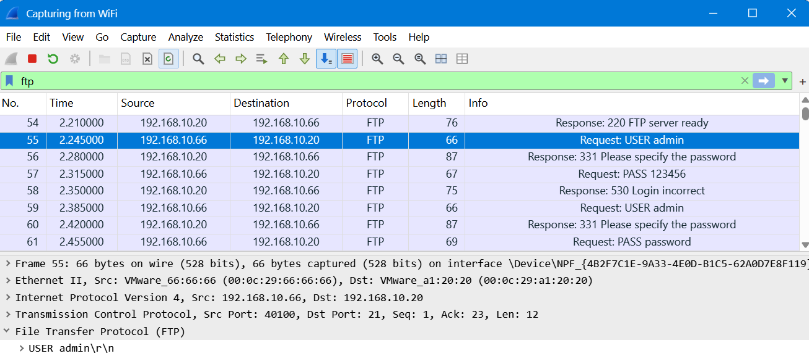
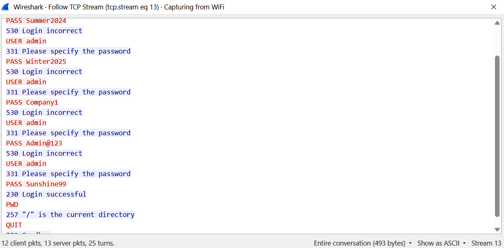

<!-- V2tWb1lXSnRVbGhoU0ZwTlltdEtjRnBYYXpWaFJYaFlUbGh3YTJKV1NqRlVSRXAzVFd4d1dWTnRNV3RXZWxaeldsVk5lRTVYU25SUFZ6QTk= -->

# &#76;&#97;&#98; 07 - &#67;&#97;&#116;&#99;&#104; &#116;&#104;&#101; &#66;&#114;&#117;&#116;&#101; &#70;&#111;&#114;&#99;&#101; &#65;&#116;&#116;&#97;&#99;&#107;&#101;&#114;

## &#79;&#98;&#106;&#101;&#99;&#116;&#105;&#118;&#101;

&#65;&#110;&#97;&#108;&#121;&#122;&#101; &#70;&#84;&#80; &#116;&#114;&#97;&#102;&#102;&#105;&#99; &#116;&#111; &#105;&#100;&#101;&#110;&#116;&#105;&#102;&#121; &#114;&#101;&#112;&#101;&#97;&#116;&#101;&#100; &#108;&#111;&#103;&#105;&#110; &#97;&#116;&#116;&#101;&#109;&#112;&#116;&#115;, &#100;&#101;&#116;&#101;&#114;&#109;&#105;&#110;&#101; &#116;&#104;&#101; &#115;&#111;&#117;&#114;&#99;&#101; &#111;&#102; &#116;&#104;&#101; &#97;&#116;&#116;&#97;&#99;&#107;, &#97;&#110;&#100; &#117;&#110;&#99;&#111;&#118;&#101;&#114; &#99;&#114;&#101;&#100;&#101;&#110;&#116;&#105;&#97;&#108;&#115; &#117;&#115;&#101;&#100; &#105;&#110; &#97; &#115;&#117;&#99;&#99;&#101;&#115;&#115;&#102;&#117;&#108; &#108;&#111;&#103;&#105;&#110;.

## &#80;&#97;&#99;&#107;&#101;&#116; &#65;&#110;&#97;&#108;&#121;&#115;&#105;&#115;

### 1. &#72;&#111;&#119; &#109;&#97;&#110;&#121; &#112;&#97;&#99;&#107;&#101;&#116;&#115; &#100;&#105;&#100; &#87;&#105;&#114;&#101;&#115;&#104;&#97;&#114;&#107; &#99;&#97;&#112;&#116;&#117;&#114;&#101;?

&#67;&#104;&#101;&#99;&#107; &#116;&#104;&#101; &#116;&#111;&#116;&#97;&#108; &#112;&#97;&#99;&#107;&#101;&#116; &#99;&#111;&#117;&#110;&#116; &#105;&#110; &#87;&#105;&#114;&#101;&#115;&#104;&#97;&#114;&#107;.

**&#70;&#105;&#110;&#100;&#105;&#110;&#103;:** `369 packets`

### 2. &#87;&#104;&#105;&#99;&#104; &#112;&#114;&#111;&#116;&#111;&#99;&#111;&#108; &#119;&#97;&#115; &#117;&#115;&#101;&#100; &#102;&#111;&#114; &#116;&#104;&#101; &#108;&#111;&#103;&#105;&#110; &#97;&#116;&#116;&#101;&#109;&#112;&#116;&#115;?

&#78;&#97;&#118;&#105;&#103;&#97;&#116;&#101; &#116;&#111; `Statistics → Protocol Hierarchy` &#97;&#110;&#100; &#101;&#120;&#112;&#97;&#110;&#100; &#116;&#104;&#101; &#112;&#114;&#111;&#116;&#111;&#99;&#111;&#108; &#116;&#114;&#101;&#101;. &#76;&#111;&#99;&#97;&#116;&#101; &#70;&#84;&#80; &#97;&#110;&#100; &#118;&#101;&#114;&#105;&#102;&#121; &#116;&#104;&#97;&#116; &#105;&#116; &#99;&#111;&#110;&#116;&#97;&#105;&#110;&#115; &#116;&#104;&#101; &#108;&#111;&#103;&#105;&#110; &#116;&#114;&#97;&#102;&#102;&#105;&#99;.

**&#68;&#105;&#115;&#112;&#108;&#97;&#121; &#102;&#105;&#108;&#116;&#101;&#114;:**
```wireshark
ftp
```



**&#70;&#105;&#110;&#100;&#105;&#110;&#103;:** `FTP`

### 3. &#87;&#104;&#97;&#116; &#105;&#115; &#116;&#104;&#101; &#73;&#80; &#97;&#100;&#100;&#114;&#101;&#115;&#115; &#111;&#102; &#116;&#104;&#101; &#116;&#97;&#114;&#103;&#101;&#116;&#101;&#100; &#70;&#84;&#80; &#115;&#101;&#114;&#118;&#101;&#114;?

&#73;&#110;&#115;&#112;&#101;&#99;&#116; &#116;&#104;&#101; &#100;&#101;&#115;&#116;&#105;&#110;&#97;&#116;&#105;&#111;&#110; &#73;&#80; &#97;&#100;&#100;&#114;&#101;&#115;&#115; &#111;&#102; &#116;&#104;&#101; &#70;&#84;&#80; &#108;&#111;&#103;&#105;&#110; &#116;&#114;&#97;&#102;&#102;&#105;&#99;.

**&#70;&#105;&#110;&#100;&#105;&#110;&#103;:** `192.168.10.20`

### 4. &#87;&#104;&#105;&#99;&#104; &#73;&#80; &#97;&#100;&#100;&#114;&#101;&#115;&#115; &#115;&#101;&#110;&#116; &#116;&#104;&#101; &#108;&#111;&#103;&#105;&#110; &#97;&#116;&#116;&#101;&#109;&#112;&#116;&#115;?

&#73;&#110;&#115;&#112;&#101;&#99;&#116; &#116;&#104;&#101; &#115;&#111;&#117;&#114;&#99;&#101; &#73;&#80; &#97;&#100;&#100;&#114;&#101;&#115;&#115; &#111;&#102; &#116;&#104;&#101; &#70;&#84;&#80; &#108;&#111;&#103;&#105;&#110; &#114;&#101;&#113;&#117;&#101;&#115;&#116;&#115;.

**&#70;&#105;&#110;&#100;&#105;&#110;&#103;:** `192.168.10.66`

### 5. &#87;&#104;&#105;&#99;&#104; &#117;&#115;&#101;&#114;&#110;&#97;&#109;&#101; &#100;&#105;&#100; &#116;&#104;&#101; &#97;&#116;&#116;&#97;&#99;&#107;&#101;&#114; &#114;&#101;&#112;&#101;&#97;&#116;&#101;&#100;&#108;&#121; &#97;&#116;&#116;&#101;&#109;&#112;&#116; &#116;&#111; &#117;&#115;&#101;?

**&#68;&#105;&#115;&#112;&#108;&#97;&#121; &#102;&#105;&#108;&#116;&#101;&#114;:**
```wireshark
ftp.request.command == "USER"
```

&#73;&#110;&#115;&#112;&#101;&#99;&#116; &#116;&#104;&#101; &#70;&#84;&#80; &#85;&#83;&#69;&#82; &#99;&#111;&#109;&#109;&#97;&#110;&#100;&#115;.

**&#70;&#105;&#110;&#100;&#105;&#110;&#103;:** `admin`

### 6. &#87;&#104;&#105;&#99;&#104; &#70;&#84;&#80; &#114;&#101;&#112;&#108;&#121; &#99;&#111;&#100;&#101; &#105;&#110;&#100;&#105;&#99;&#97;&#116;&#101;&#115; &#97;&#110; &#105;&#110;&#99;&#111;&#114;&#114;&#101;&#99;&#116; &#108;&#111;&#103;&#105;&#110;?

&#73;&#110;&#115;&#112;&#101;&#99;&#116; &#116;&#104;&#101; &#70;&#84;&#80; &#115;&#101;&#114;&#118;&#101;&#114; &#114;&#101;&#115;&#112;&#111;&#110;&#115;&#101;&#115; &#116;&#111; &#116;&#104;&#101; &#108;&#111;&#103;&#105;&#110; &#97;&#116;&#116;&#101;&#109;&#112;&#116;&#115;.

**&#70;&#105;&#110;&#100;&#105;&#110;&#103;:** `530`

### 7. &#72;&#111;&#119; &#109;&#97;&#110;&#121; &#102;&#97;&#105;&#108;&#101;&#100; &#108;&#111;&#103;&#105;&#110; &#97;&#116;&#116;&#101;&#109;&#112;&#116;&#115; &#100;&#105;&#100; &#116;&#104;&#101; &#97;&#116;&#116;&#97;&#99;&#107;&#101;&#114; &#109;&#97;&#107;&#101;?

**&#68;&#105;&#115;&#112;&#108;&#97;&#121; &#102;&#105;&#108;&#116;&#101;&#114;:**
```wireshark
ftp.response.code == 530
```

&#67;&#111;&#117;&#110;&#116; &#116;&#104;&#101; &#109;&#97;&#116;&#99;&#104;&#105;&#110;&#103; &#70;&#84;&#80; &#114;&#101;&#115;&#112;&#111;&#110;&#115;&#101; &#112;&#97;&#99;&#107;&#101;&#116;&#115;.

**&#70;&#105;&#110;&#100;&#105;&#110;&#103;:** `24 failed attempts`

### 8. &#87;&#104;&#105;&#99;&#104; &#70;&#84;&#80; &#114;&#101;&#112;&#108;&#121; &#99;&#111;&#100;&#101; &#105;&#110;&#100;&#105;&#99;&#97;&#116;&#101;&#115; &#97; &#115;&#117;&#99;&#99;&#101;&#115;&#115;&#102;&#117;&#108; &#108;&#111;&#103;&#105;&#110;?

**&#68;&#105;&#115;&#112;&#108;&#97;&#121; &#102;&#105;&#108;&#116;&#101;&#114;:**
```wireshark
ftp.response.code == 230
```

**&#70;&#105;&#110;&#100;&#105;&#110;&#103;:** `230`

### 9. &#87;&#104;&#97;&#116; &#112;&#97;&#115;&#115;&#119;&#111;&#114;&#100; &#100;&#105;&#100; &#116;&#104;&#101; &#97;&#116;&#116;&#97;&#99;&#107;&#101;&#114; &#117;&#115;&#101; &#105;&#110; &#116;&#104;&#101; &#115;&#117;&#99;&#99;&#101;&#115;&#115;&#102;&#117;&#108; &#108;&#111;&#103;&#105;&#110;?

&#70;&#111;&#108;&#108;&#111;&#119; &#116;&#104;&#101; &#84;&#67;&#80; &#115;&#116;&#114;&#101;&#97;&#109; &#97;&#115;&#115;&#111;&#99;&#105;&#97;&#116;&#101;&#100; &#119;&#105;&#116;&#104; &#116;&#104;&#101; &#115;&#117;&#99;&#99;&#101;&#115;&#115;&#102;&#117;&#108; &#70;&#84;&#80; &#108;&#111;&#103;&#105;&#110; &#97;&#110;&#100; &#105;&#110;&#115;&#112;&#101;&#99;&#116; &#116;&#104;&#101; &#80;&#65;&#83;&#83; &#99;&#111;&#109;&#109;&#97;&#110;&#100;.



**&#70;&#105;&#110;&#100;&#105;&#110;&#103;:** `Sunshine99`

### 10. &#87;&#104;&#97;&#116; &#116;&#121;&#112;&#101; &#111;&#102; &#97;&#116;&#116;&#97;&#99;&#107; &#105;&#110;&#118;&#111;&#108;&#118;&#101;&#115; &#114;&#101;&#112;&#101;&#97;&#116;&#101;&#100;&#108;&#121; &#103;&#117;&#101;&#115;&#115;&#105;&#110;&#103; &#112;&#97;&#115;&#115;&#119;&#111;&#114;&#100;&#115; &#102;&#111;&#114; &#111;&#110;&#101; &#117;&#115;&#101;&#114; &#117;&#110;&#116;&#105;&#108; &#97; &#115;&#117;&#99;&#99;&#101;&#115;&#115;&#102;&#117;&#108; &#108;&#111;&#103;&#105;&#110; &#111;&#99;&#99;&#117;&#114;&#115;?

**&#70;&#105;&#110;&#100;&#105;&#110;&#103;:** &#70;&#84;&#80; &#66;&#114;&#117;&#116;&#101;-&#70;&#111;&#114;&#99;&#101; &#65;&#116;&#116;&#97;&#99;&#107;

## &#76;&#101;&#115;&#115;&#111;&#110;&#115; &#76;&#101;&#97;&#114;&#110;&#101;&#100;

## &#76;&#101;&#115;&#115;&#111;&#110;&#115; &#76;&#101;&#97;&#114;&#110;&#101;&#100;

## &#76;&#101;&#115;&#115;&#111;&#110;&#115; &#76;&#101;&#97;&#114;&#110;&#101;&#100;

- &#85;&#110;&#100;&#101;&#114;&#115;&#116;&#97;&#110;&#100;&#105;&#110;&#103; &#70;&#84;&#80; &#99;&#111;&#109;&#109;&#117;&#110;&#105;&#99;&#97;&#116;&#105;&#111;&#110; &#104;&#101;&#108;&#112;&#115; &#105;&#100;&#101;&#110;&#116;&#105;&#102;&#121; &#97;&#117;&#116;&#104;&#101;&#110;&#116;&#105;&#99;&#97;&#116;&#105;&#111;&#110; &#99;&#111;&#109;&#109;&#97;&#110;&#100;&#115; &#97;&#110;&#100; &#115;&#101;&#114;&#118;&#101;&#114; &#114;&#101;&#115;&#112;&#111;&#110;&#115;&#101;&#115;.
- &#72;&#84;&#84;&#80; &#97;&#110;&#100; &#70;&#84;&#80; &#117;&#115;&#101; &#100;&#105;&#102;&#102;&#101;&#114;&#101;&#110;&#116; &#114;&#101;&#115;&#112;&#111;&#110;&#115;&#101; &#99;&#111;&#100;&#101; &#115;&#121;&#115;&#116;&#101;&#109;&#115;. &#72;&#84;&#84;&#80; &#115;&#116;&#97;&#116;&#117;&#115; &#99;&#111;&#100;&#101;&#115; &#105;&#110;&#100;&#105;&#99;&#97;&#116;&#101; &#119;&#101;&#98; &#114;&#101;&#113;&#117;&#101;&#115;&#116; &#111;&#117;&#116;&#99;&#111;&#109;&#101;&#115;, &#119;&#104;&#105;&#108;&#101; &#70;&#84;&#80; &#114;&#101;&#112;&#108;&#121; &#99;&#111;&#100;&#101;&#115; &#105;&#110;&#100;&#105;&#99;&#97;&#116;&#101; &#116;&#104;&#101; &#115;&#116;&#97;&#116;&#117;&#115; &#111;&#102; &#99;&#111;&#109;&#109;&#97;&#110;&#100;&#115; &#97;&#110;&#100; &#97;&#117;&#116;&#104;&#101;&#110;&#116;&#105;&#99;&#97;&#116;&#105;&#111;&#110; &#115;&#101;&#115;&#115;&#105;&#111;&#110;&#115;.
- &#70;&#84;&#80; &#114;&#101;&#115;&#112;&#111;&#110;&#115;&#101; &#99;&#111;&#100;&#101;&#115; &#104;&#101;&#108;&#112; &#100;&#105;&#115;&#116;&#105;&#110;&#103;&#117;&#105;&#115;&#104; &#102;&#97;&#105;&#108;&#101;&#100; &#97;&#117;&#116;&#104;&#101;&#110;&#116;&#105;&#99;&#97;&#116;&#105;&#111;&#110; &#97;&#116;&#116;&#101;&#109;&#112;&#116;&#115; (`530`) &#102;&#114;&#111;&#109; &#115;&#117;&#99;&#99;&#101;&#115;&#115;&#102;&#117;&#108; &#108;&#111;&#103;&#105;&#110;&#115; (`230`).
- &#70;&#84;&#80; &#116;&#114;&#97;&#110;&#115;&#109;&#105;&#116;&#115; &#117;&#115;&#101;&#114;&#110;&#97;&#109;&#101;&#115; &#97;&#110;&#100; &#112;&#97;&#115;&#115;&#119;&#111;&#114;&#100;&#115; &#105;&#110; &#112;&#108;&#97;&#105;&#110;&#116;&#101;&#120;&#116;, &#109;&#97;&#107;&#105;&#110;&#103; &#99;&#114;&#101;&#100;&#101;&#110;&#116;&#105;&#97;&#108;&#115; &#118;&#105;&#115;&#105;&#98;&#108;&#101; &#116;&#104;&#114;&#111;&#117;&#103;&#104; &#112;&#97;&#99;&#107;&#101;&#116; &#99;&#97;&#112;&#116;&#117;&#114;&#101;.
- &#82;&#101;&#112;&#101;&#97;&#116;&#101;&#100; &#108;&#111;&#103;&#105;&#110; &#97;&#116;&#116;&#101;&#109;&#112;&#116;&#115; &#97;&#103;&#97;&#105;&#110;&#115;&#116; &#116;&#104;&#101; &#115;&#97;&#109;&#101; &#117;&#115;&#101;&#114;&#110;&#97;&#109;&#101; &#99;&#97;&#110; &#105;&#110;&#100;&#105;&#99;&#97;&#116;&#101; &#98;&#114;&#117;&#116;&#101;-&#102;&#111;&#114;&#99;&#101; &#97;&#99;&#116;&#105;&#118;&#105;&#116;&#121;.
- &#65;&#110;&#97;&#108;&#121;&#122;&#105;&#110;&#103; &#115;&#111;&#117;&#114;&#99;&#101; &#97;&#110;&#100; &#100;&#101;&#115;&#116;&#105;&#110;&#97;&#116;&#105;&#111;&#110; &#73;&#80; &#97;&#100;&#100;&#114;&#101;&#115;&#115;&#101;&#115; &#104;&#101;&#108;&#112;&#115; &#105;&#100;&#101;&#110;&#116;&#105;&#102;&#121; &#116;&#104;&#101; &#97;&#116;&#116;&#97;&#99;&#107;&#101;&#114; &#97;&#110;&#100; &#116;&#97;&#114;&#103;&#101;&#116;&#101;&#100; &#115;&#101;&#114;&#118;&#101;&#114;.
- &#70;&#111;&#108;&#108;&#111;&#119; &#84;&#67;&#80; &#83;&#116;&#114;&#101;&#97;&#109; &#99;&#97;&#110; &#114;&#101;&#99;&#111;&#110;&#115;&#116;&#114;&#117;&#99;&#116; &#70;&#84;&#80; &#99;&#111;&#110;&#118;&#101;&#114;&#115;&#97;&#116;&#105;&#111;&#110;&#115; &#97;&#110;&#100; &#114;&#101;&#118;&#101;&#97;&#108; &#99;&#114;&#101;&#100;&#101;&#110;&#116;&#105;&#97;&#108;&#115; &#101;&#120;&#99;&#104;&#97;&#110;&#103;&#101;&#100; &#100;&#117;&#114;&#105;&#110;&#103; &#97;&#117;&#116;&#104;&#101;&#110;&#116;&#105;&#99;&#97;&#116;&#105;&#111;&#110;.

---

<div align="center">
  <sub> &#67;&#114;&#101;&#97;&#116;&#101;&#100; &#98;&#121; <a href="https://github.com/n-afiqa/">@&#110;-&#97;&#102;&#105;&#113;&#97;</a> · © 2026</sub>
</div>
