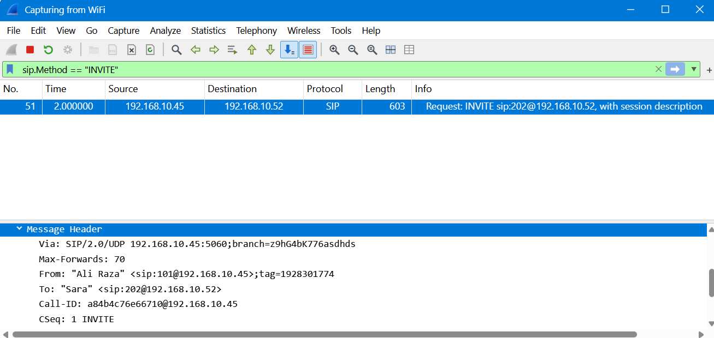
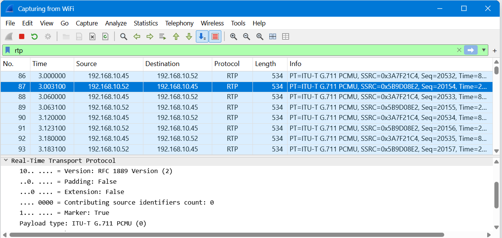
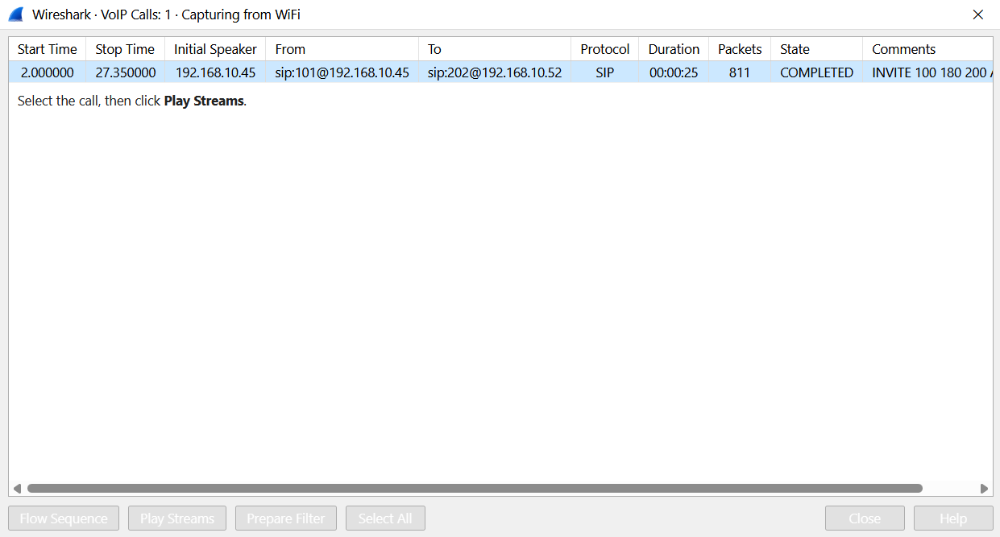
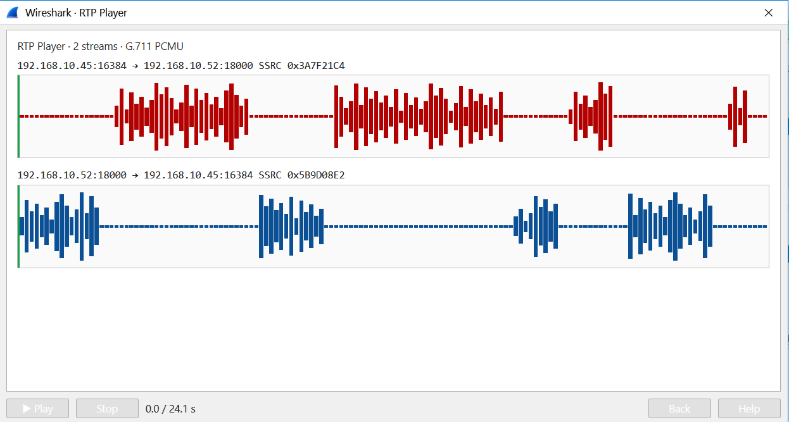

<!-- V2tWb1lXSnRVbGhoU0ZwTlltdEtjRnBYYXpWaFJYaFlUbGh3YTJKV1NqRlVSRXAzVFd4d1dWTnRNV3RXZWxaeldsVk5lRTVYU25SUFZ6QTk= -->

# &#76;&#97;&#98; 8 - &#67;&#97;&#116;&#99;&#104; &#116;&#104;&#101; &#67;&#97;&#108;&#108; &#83;&#99;&#97;&#109;&#109;&#101;&#114;

## &#79;&#98;&#106;&#101;&#99;&#116;&#105;&#118;&#101;

&#73;&#110;&#118;&#101;&#115;&#116;&#105;&#103;&#97;&#116;&#101; &#99;&#97;&#112;&#116;&#117;&#114;&#101;&#100; &#110;&#101;&#116;&#119;&#111;&#114;&#107; &#116;&#114;&#97;&#102;&#102;&#105;&#99; &#116;&#111; &#105;&#100;&#101;&#110;&#116;&#105;&#102;&#121; &#97; &#99;&#97;&#108;&#108; &#115;&#99;&#97;&#109;&#109;&#101;&#114; &#97;&#110;&#100; &#97;&#110;&#97;&#108;&#121;&#122;&#101; &#116;&#104;&#101; &#86;&#111;&#73;&#80; &#99;&#111;&#109;&#109;&#117;&#110;&#105;&#99;&#97;&#116;&#105;&#111;&#110;.

## &#80;&#97;&#99;&#107;&#101;&#116; &#65;&#110;&#97;&#108;&#121;&#115;&#105;&#115;

### 1. &#72;&#111;&#119; &#109;&#97;&#110;&#121; &#112;&#97;&#99;&#107;&#101;&#116;&#115; &#100;&#105;&#100; &#87;&#105;&#114;&#101;&#115;&#104;&#97;&#114;&#107; &#99;&#97;&#112;&#116;&#117;&#114;&#101;?

&#67;&#104;&#101;&#99;&#107; &#116;&#104;&#101; &#116;&#111;&#116;&#97;&#108; &#112;&#97;&#99;&#107;&#101;&#116; &#99;&#111;&#117;&#110;&#116; &#105;&#110; &#87;&#105;&#114;&#101;&#115;&#104;&#97;&#114;&#107;.

**&#70;&#105;&#110;&#100;&#105;&#110;&#103;:** `1051 packets`

### 2. &#87;&#104;&#105;&#99;&#104; &#112;&#114;&#111;&#116;&#111;&#99;&#111;&#108; &#115;&#101;&#116; &#117;&#112; &#116;&#104;&#101; &#99;&#97;&#108;&#108; (&#73;&#78;&#86;&#73;&#84;&#69;, &#82;&#105;&#110;&#103;&#105;&#110;&#103;, &#79;&#75;)?

**&#68;&#105;&#115;&#112;&#108;&#97;&#121; &#102;&#105;&#108;&#116;&#101;&#114;:**
```wireshark
sip
```

**&#70;&#105;&#110;&#100;&#105;&#110;&#103;:** `SIP`

> **&#83;&#73;&#80;:** &#72;&#97;&#110;&#100;&#108;&#101;&#115; &#99;&#97;&#108;&#108; &#115;&#101;&#116;&#117;&#112; &#97;&#110;&#100; &#115;&#105;&#103;&#110;&#97;&#108;&#108;&#105;&#110;&#103;.

### 3. &#87;&#104;&#105;&#99;&#104; &#112;&#114;&#111;&#116;&#111;&#99;&#111;&#108; &#99;&#97;&#114;&#114;&#105;&#101;&#100; &#116;&#104;&#101; &#118;&#111;&#105;&#99;&#101; &#105;&#116;&#115;&#101;&#108;&#102;?

**&#68;&#105;&#115;&#112;&#108;&#97;&#121; &#102;&#105;&#108;&#116;&#101;&#114;:**
```wireshark
rtp
```
**&#70;&#105;&#110;&#100;&#105;&#110;&#103;:** `RTP`

> **&#82;&#84;&#80;:** &#67;&#97;&#114;&#114;&#105;&#101;&#115; &#116;&#104;&#101; &#118;&#111;&#105;&#99;&#101; &#100;&#97;&#116;&#97;.

### 4. &#87;&#104;&#105;&#99;&#104; &#101;&#120;&#116;&#101;&#110;&#115;&#105;&#111;&#110; &#110;&#117;&#109;&#98;&#101;&#114; &#109;&#97;&#100;&#101; &#116;&#104;&#101; &#99;&#97;&#108;&#108;?

**&#68;&#105;&#115;&#112;&#108;&#97;&#121; &#102;&#105;&#108;&#116;&#101;&#114;:**
```wireshark
sip.Method == "INVITE"
```



&#73;&#110;&#115;&#112;&#101;&#99;&#116; &#116;&#104;&#101; &#83;&#73;&#80; &#73;&#78;&#86;&#73;&#84;&#69; &#114;&#101;&#113;&#117;&#101;&#115;&#116; &#102;&#111;&#114; &#116;&#104;&#101; &#99;&#97;&#108;&#108;&#101;&#114;'&#115; &#101;&#120;&#116;&#101;&#110;&#115;&#105;&#111;&#110; &#110;&#117;&#109;&#98;&#101;&#114;.

**&#70;&#105;&#110;&#100;&#105;&#110;&#103;:** `101`

### 5. &#87;&#104;&#97;&#116; &#105;&#115; &#116;&#104;&#101; &#110;&#97;&#109;&#101; &#111;&#102; &#116;&#104;&#101; &#99;&#97;&#108;&#108;&#101;&#114;?

&#73;&#110;&#115;&#112;&#101;&#99;&#116; &#116;&#104;&#101; &#83;&#73;&#80; &#73;&#78;&#86;&#73;&#84;&#69; &#100;&#101;&#116;&#97;&#105;&#108;&#115; &#102;&#111;&#114; &#116;&#104;&#101; &#99;&#97;&#108;&#108;&#101;&#114;'&#115; &#105;&#100;&#101;&#110;&#116;&#105;&#116;&#121;.

**&#70;&#105;&#110;&#100;&#105;&#110;&#103;:** `Ali Raza`

### 6. &#87;&#104;&#105;&#99;&#104; &#99;&#111;&#100;&#101;&#99; &#99;&#97;&#114;&#114;&#105;&#101;&#100; &#116;&#104;&#101; &#118;&#111;&#105;&#99;&#101;?

**&#68;&#105;&#115;&#112;&#108;&#97;&#121; &#102;&#105;&#108;&#116;&#101;&#114;:**
```wireshark
rtp
```



&#83;&#101;&#108;&#101;&#99;&#116; &#97;&#110; &#82;&#84;&#80; &#112;&#97;&#99;&#107;&#101;&#116; &#97;&#110;&#100; &#101;&#120;&#112;&#97;&#110;&#100; **&#82;&#101;&#97;&#108;-&#84;&#105;&#109;&#101; &#84;&#114;&#97;&#110;&#115;&#112;&#111;&#114;&#116; &#80;&#114;&#111;&#116;&#111;&#99;&#111;&#108;** &#116;&#111; &#105;&#110;&#115;&#112;&#101;&#99;&#116; &#116;&#104;&#101; &#80;&#97;&#121;&#108;&#111;&#97;&#100; &#84;&#121;&#112;&#101; &#102;&#105;&#101;&#108;&#100;.

**&#70;&#105;&#110;&#100;&#105;&#110;&#103;:** `PCMU`

### 7. &#87;&#104;&#111; &#97;&#110;&#115;&#119;&#101;&#114;&#101;&#100; &#116;&#104;&#101; &#99;&#97;&#108;&#108;?

&#78;&#97;&#118;&#105;&#103;&#97;&#116;&#101; &#116;&#111; `Telephony → VoIP Calls`, &#115;&#101;&#108;&#101;&#99;&#116; &#116;&#104;&#101; &#99;&#97;&#108;&#108;, &#97;&#110;&#100; &#112;&#108;&#97;&#121; &#116;&#104;&#101; &#97;&#117;&#100;&#105;&#111; &#116;&#111; &#105;&#100;&#101;&#110;&#116;&#105;&#102;&#121; &#116;&#104;&#101; &#112;&#101;&#114;&#115;&#111;&#110; &#119;&#104;&#111; &#97;&#110;&#115;&#119;&#101;&#114;&#101;&#100;.





**&#70;&#105;&#110;&#100;&#105;&#110;&#103;:** `Sara`

### 8. &#87;&#104;&#97;&#116; &#97;&#114;&#101; &#116;&#104;&#101; &#108;&#97;&#115;&#116; &#102;&#111;&#117;&#114; &#100;&#105;&#103;&#105;&#116;&#115; &#111;&#102; &#116;&#104;&#101; &#99;&#97;&#114;&#100; &#110;&#117;&#109;&#98;&#101;&#114;?

&#67;&#111;&#110;&#116;&#105;&#110;&#117;&#101; &#108;&#105;&#115;&#116;&#101;&#110;&#105;&#110;&#103; &#116;&#111; &#116;&#104;&#101; &#99;&#97;&#108;&#108; &#97;&#117;&#100;&#105;&#111; &#116;&#111; &#105;&#100;&#101;&#110;&#116;&#105;&#102;&#121; &#116;&#104;&#101; &#99;&#97;&#108;&#108;&#101;&#114;'&#115; &#115;&#112;&#111;&#107;&#101;&#110; &#99;&#97;&#114;&#100; &#100;&#101;&#116;&#97;&#105;&#108;&#115;.

**&#70;&#105;&#110;&#100;&#105;&#110;&#103;:** `2394`

### 9. &#87;&#104;&#97;&#116; &#101;&#120;&#112;&#105;&#114;&#121; &#100;&#97;&#116;&#101; &#100;&#105;&#100; &#116;&#104;&#101; &#99;&#97;&#108;&#108;&#101;&#114; &#115;&#97;&#121;?

&#67;&#111;&#110;&#116;&#105;&#110;&#117;&#101; &#108;&#105;&#115;&#116;&#101;&#110;&#105;&#110;&#103; &#116;&#111; &#116;&#104;&#101; &#99;&#97;&#108;&#108; &#97;&#117;&#100;&#105;&#111; &#116;&#111; &#105;&#100;&#101;&#110;&#116;&#105;&#102;&#121; &#116;&#104;&#101; &#99;&#97;&#114;&#100; &#101;&#120;&#112;&#105;&#114;&#121; &#100;&#97;&#116;&#101;.

**&#70;&#105;&#110;&#100;&#105;&#110;&#103;:** `09/28`

### 10. &#72;&#111;&#119; &#99;&#97;&#110; &#116;&#104;&#101; &#99;&#111;&#109;&#112;&#97;&#110;&#121; &#112;&#114;&#101;&#118;&#101;&#110;&#116; &#112;&#101;&#111;&#112;&#108;&#101; &#102;&#114;&#111;&#109; &#108;&#105;&#115;&#116;&#101;&#110;&#105;&#110;&#103; &#116;&#111; &#99;&#97;&#108;&#108;&#115;?

&#69;&#110;&#99;&#114;&#121;&#112;&#116; &#118;&#111;&#105;&#99;&#101; &#99;&#111;&#109;&#109;&#117;&#110;&#105;&#99;&#97;&#116;&#105;&#111;&#110; &#117;&#115;&#105;&#110;&#103; &#83;&#101;&#99;&#117;&#114;&#101; &#82;&#101;&#97;&#108;-&#116;&#105;&#109;&#101; &#84;&#114;&#97;&#110;&#115;&#112;&#111;&#114;&#116; &#80;&#114;&#111;&#116;&#111;&#99;&#111;&#108; (&#83;&#82;&#84;&#80;).

**&#70;&#105;&#110;&#100;&#105;&#110;&#103;:** `Encrypt the call (SRTP)`

## &#76;&#101;&#115;&#115;&#111;&#110;&#115; &#76;&#101;&#97;&#114;&#110;&#101;&#100;

- &#85;&#110;&#100;&#101;&#114;&#115;&#116;&#97;&#110;&#100;&#105;&#110;&#103; &#86;&#111;&#73;&#80; &#99;&#111;&#109;&#109;&#117;&#110;&#105;&#99;&#97;&#116;&#105;&#111;&#110; &#104;&#101;&#108;&#112;&#115; &#100;&#105;&#115;&#116;&#105;&#110;&#103;&#117;&#105;&#115;&#104; &#99;&#97;&#108;&#108; &#115;&#105;&#103;&#110;&#97;&#108;&#108;&#105;&#110;&#103; &#102;&#114;&#111;&#109; &#118;&#111;&#105;&#99;&#101; &#116;&#114;&#97;&#110;&#115;&#109;&#105;&#115;&#115;&#105;&#111;&#110;.
- &#83;&#73;&#80; &#109;&#97;&#110;&#97;&#103;&#101;&#115; &#99;&#97;&#108;&#108; &#115;&#101;&#116;&#117;&#112; &#97;&#110;&#100; &#115;&#105;&#103;&#110;&#97;&#108;&#108;&#105;&#110;&#103;, &#119;&#104;&#105;&#108;&#101; &#82;&#84;&#80; &#99;&#97;&#114;&#114;&#105;&#101;&#115; &#116;&#104;&#101; &#118;&#111;&#105;&#99;&#101; &#100;&#97;&#116;&#97;.
- &#83;&#73;&#80; &#109;&#101;&#115;&#115;&#97;&#103;&#101;&#115; &#99;&#97;&#110; &#101;&#120;&#112;&#111;&#115;&#101; &#99;&#97;&#108;&#108;&#101;&#114; &#105;&#110;&#102;&#111;&#114;&#109;&#97;&#116;&#105;&#111;&#110;, &#105;&#110;&#99;&#108;&#117;&#100;&#105;&#110;&#103; &#101;&#120;&#116;&#101;&#110;&#115;&#105;&#111;&#110; &#110;&#117;&#109;&#98;&#101;&#114;&#115; &#97;&#110;&#100; &#110;&#97;&#109;&#101;&#115;.
- &#82;&#84;&#80; &#112;&#97;&#121;&#108;&#111;&#97;&#100; &#116;&#121;&#112;&#101;&#115; &#105;&#100;&#101;&#110;&#116;&#105;&#102;&#121; &#116;&#104;&#101; &#99;&#111;&#100;&#101;&#99; &#117;&#115;&#101;&#100; &#116;&#111; &#101;&#110;&#99;&#111;&#100;&#101; &#118;&#111;&#105;&#99;&#101; &#100;&#97;&#116;&#97;.
- &#85;&#110;&#101;&#110;&#99;&#114;&#121;&#112;&#116;&#101;&#100; &#86;&#111;&#73;&#80; &#116;&#114;&#97;&#102;&#102;&#105;&#99; &#99;&#97;&#110; &#101;&#120;&#112;&#111;&#115;&#101; &#112;&#114;&#105;&#118;&#97;&#116;&#101; &#99;&#111;&#110;&#118;&#101;&#114;&#115;&#97;&#116;&#105;&#111;&#110;&#115; &#97;&#110;&#100; &#115;&#101;&#110;&#115;&#105;&#116;&#105;&#118;&#101; &#105;&#110;&#102;&#111;&#114;&#109;&#97;&#116;&#105;&#111;&#110;, &#105;&#110;&#99;&#108;&#117;&#100;&#105;&#110;&#103; &#112;&#97;&#121;&#109;&#101;&#110;&#116; &#99;&#97;&#114;&#100; &#100;&#101;&#116;&#97;&#105;&#108;&#115;.
- &#87;&#105;&#114;&#101;&#115;&#104;&#97;&#114;&#107;'&#115; &#86;&#111;&#73;&#80; &#97;&#110;&#97;&#108;&#121;&#115;&#105;&#115; &#116;&#111;&#111;&#108;&#115; &#99;&#97;&#110; &#114;&#101;&#99;&#111;&#110;&#115;&#116;&#114;&#117;&#99;&#116; &#97;&#110;&#100; &#112;&#108;&#97;&#121; &#99;&#97;&#112;&#116;&#117;&#114;&#101;&#100; &#99;&#97;&#108;&#108;&#115; &#102;&#111;&#114; &#105;&#110;&#118;&#101;&#115;&#116;&#105;&#103;&#97;&#116;&#105;&#111;&#110;.
- &#83;&#82;&#84;&#80; &#101;&#110;&#99;&#114;&#121;&#112;&#116;

---

<div align="center">
  <sub> &#67;&#114;&#101;&#97;&#116;&#101;&#100; &#98;&#121; <a href="https://github.com/n-afiqa/">@&#110;-&#97;&#102;&#105;&#113;&#97;</a> · © 2026</sub>
</div>
